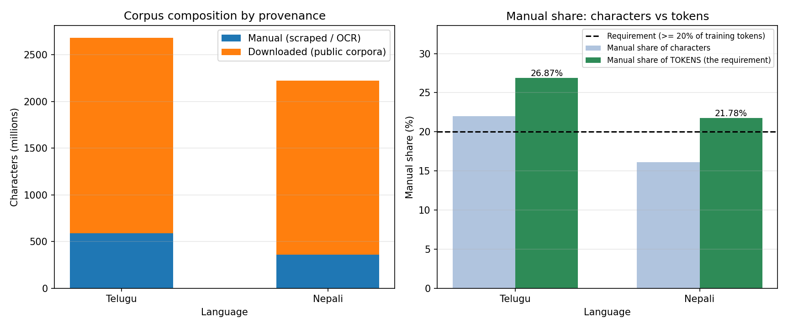
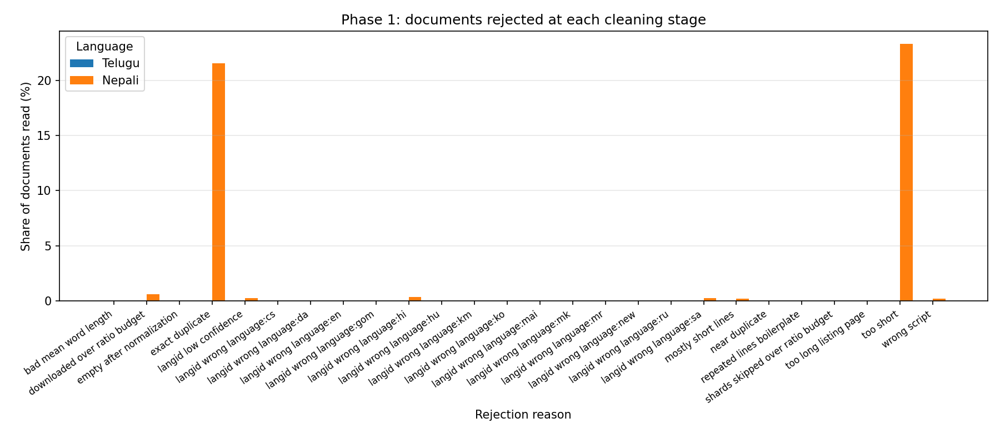
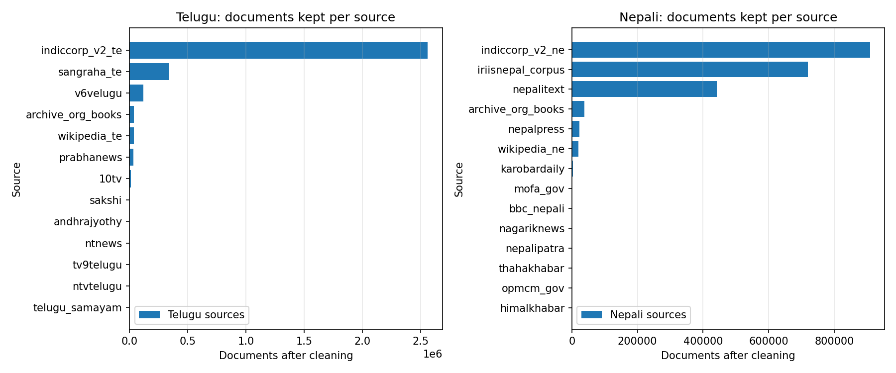
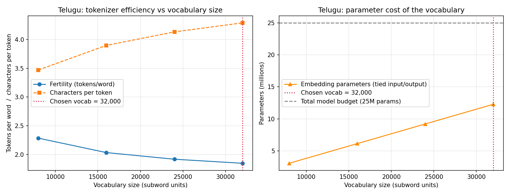
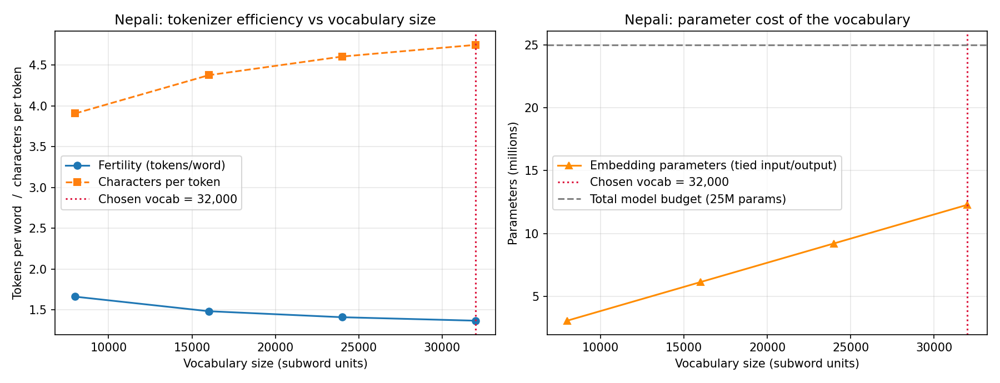

# Phase 1 — Data Collection and Tokenizer Construction

Model H: **Telugu** (higher-resource) · Model L: **Nepali** (lower-resource, from the permitted list).

The two corpora share no document, no tokenizer, and no vocabulary. Pipeline *code* is shared; all *data* is separate by construction, and the statistics below are computed independently per language.

## 1. Corpus size

| Language | Documents | Characters | **Tokens (exact)** | Chars/token |
|---|---|---|---|---|
| Telugu | 3,139,945 | 2,679,035,867 | 674,176,616 | 3.97 |
| Nepali | 2,152,701 | 2,220,405,505 | 511,303,554 | 4.34 |

Token counts are measured by encoding the corpus with the trained tokenizer, not estimated from a characters-per-token assumption.

## 2. Provenance and the ≥20% manual requirement

| Language | Manual chars | Downloaded chars | Manual char share | Manual train tokens | Manual TOKEN share | ≥20%? |
|---|---|---|---|---|---|---|
| Telugu | 589,327,781 | 2,089,708,086 | 22.0% | 179,057,619 | 26.9% | PASS |
| Nepali | 358,129,769 | 1,862,275,736 | 16.1% | 109,203,423 | 21.8% | PASS |

**The ≥20% requirement is stated in tokens, so the rightmost column is the one that decides compliance.** The character share is reported beside it deliberately: the two differ, and the difference is not noise. The cleaning stage enforces the ratio on characters (it runs before any tokenizer exists), while manually collected text — news prose and OCR'd books — tokenizes at a different rate than bulk web crawl. Quoting only the character share would understate compliance; quoting only the token share would hide the mechanism.

The manual share is computed from per-document provenance tags recorded at collection time and re-counted during the single tokenization pass in `common/encode_corpus.py`, so it is auditable rather than asserted. Any document with a missing or malformed provenance tag is counted as downloaded, so the reported manual share can only ever be an underestimate.

Surplus downloaded text is discarded by the cleaning stage to hold the ratio — a smaller corpus that satisfies the constraint is preferable to a larger one that violates it.

## 3. Cleaning funnel

| Language | Read | Kept | Keep rate |
|---|---|---|---|
| Telugu | 6,900,000 | 3,139,945 | 45.5% |
| Nepali | 4,053,265 | 2,152,701 | 53.1% |

**Nepali — rejections by reason**

| Reason | Documents | % of read |
|---|---|---|
| too short | 943,796 | 23.28% |
| exact duplicate | 872,618 | 21.53% |
| downloaded over ratio budget | 24,541 | 0.61% |
| langid wrong language:hi | 14,195 | 0.35% |
| langid wrong language:sa | 11,775 | 0.29% |
| langid low confidence | 11,369 | 0.28% |
| wrong script | 8,755 | 0.22% |
| mostly short lines | 8,362 | 0.21% |
| near duplicate | 1,662 | 0.04% |
| repeated lines boilerplate | 1,539 | 0.04% |
| langid wrong language:mr | 947 | 0.02% |
| langid wrong language:new | 826 | 0.02% |
| langid wrong language:en | 62 | 0.00% |
| langid wrong language:da | 49 | 0.00% |
| too long listing page | 20 | 0.00% |
| bad mean word length | 18 | 0.00% |
| langid wrong language:ru | 12 | 0.00% |
| shards skipped over ratio budget | 11 | 0.00% |
| langid wrong language:hu | 4 | 0.00% |
| langid wrong language:mai | 4 | 0.00% |
| langid wrong language:km | 3 | 0.00% |
| empty after normalization | 2 | 0.00% |
| langid wrong language:gom | 2 | 0.00% |
| langid wrong language:cs | 1 | 0.00% |
| langid wrong language:ko | 1 | 0.00% |
| langid wrong language:mk | 1 | 0.00% |

## 4. Tokenizers

### Telugu

| Vocab | Fertility (tok/word) | Chars/token | UNK rate | Embedding params |
|---|---|---|---|---|
| 8,000 | 2.2855 | 3.470 | 0.00e+00 | 3.07M |
| 16,000 | 2.0347 | 3.898 | 0.00e+00 | 6.14M |
| 24,000 | 1.9194 | 4.132 | 0.00e+00 | 9.22M |
| 32,000 | 1.8490 | 4.289 | 0.00e+00 | 12.29M |

**Chosen: 16,000** (`telugu_sp_16000.model`). Selected as the smallest vocabulary within 3% of the best fertility — vocabulary is bought directly out of the ~25M parameter budget, since the embedding matrix is tied to the output head.

### Nepali

| Vocab | Fertility (tok/word) | Chars/token | UNK rate | Embedding params |
|---|---|---|---|---|
| 8,000 | 1.6619 | 3.907 | 0.00e+00 | 3.07M |
| 16,000 | 1.4839 | 4.375 | 0.00e+00 | 6.14M |
| 24,000 | 1.4103 | 4.604 | 0.00e+00 | 9.22M |
| 32,000 | 1.3678 | 4.747 | 0.00e+00 | 12.29M |

**Chosen: 16,000** (`nepali_sp_16000.model`). Selected as the smallest vocabulary within 3% of the best fertility — vocabulary is bought directly out of the ~25M parameter budget, since the embedding matrix is tied to the output head.

## 5. Splits

| Language | Split | Documents | Tokens | UTF-8 bytes |
|---|---|---|---|---|
| Telugu | train | 3,099,947 | 666,507,564 | 7,068,029,536 |
| Telugu | validation | 19,998 | 3,766,723 | 38,880,989 |
| Telugu | test | 20,000 | 3,902,329 | 39,994,637 |
| Nepali | train | 2,112,701 | 501,331,128 | 5,802,543,659 |
| Nepali | validation | 20,000 | 4,970,840 | 57,259,503 |
| Nepali | test | 20,000 | 5,001,586 | 57,579,191 |

Splits are assigned per **document** by hashing the document id, never per line — a line-level split would place sentences from one article in both train and test. Deduplication runs *before* splitting, so a document and its near-duplicate cannot straddle the boundary and leak test data into training.

UTF-8 byte counts are recorded because Phase 2 reports bits-per-byte, which is the only fair way to compare two models whose tokenizers compress at different rates.
