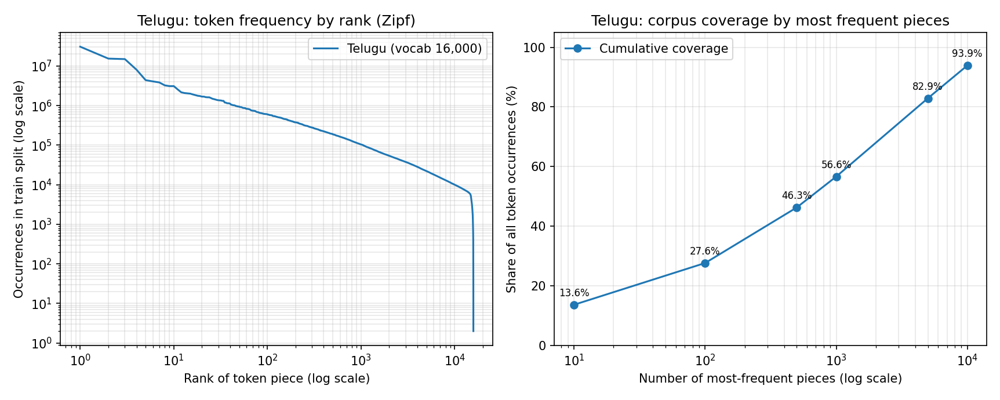
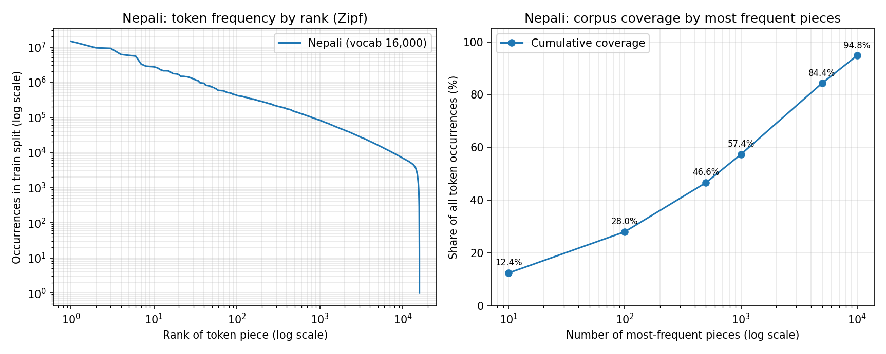
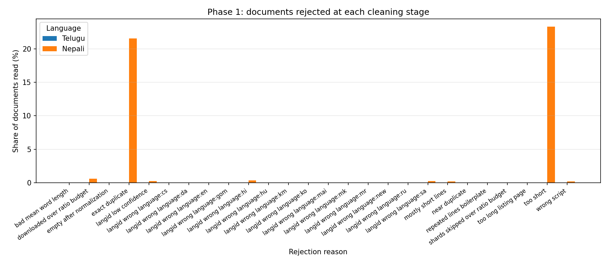
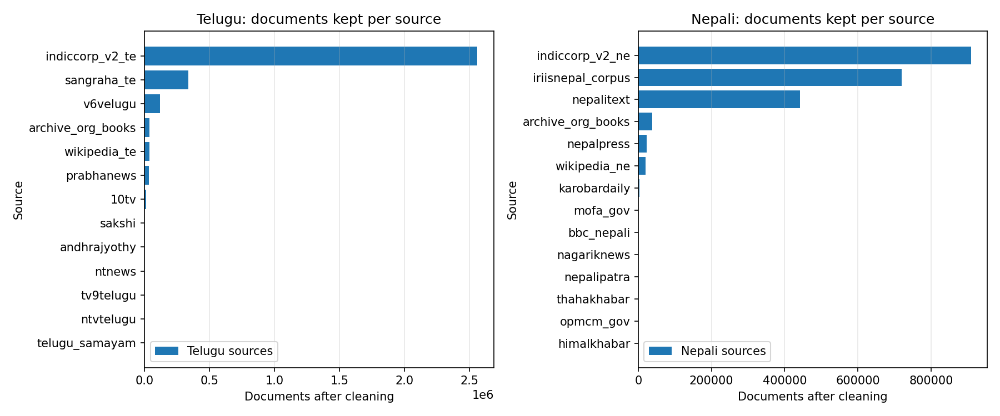
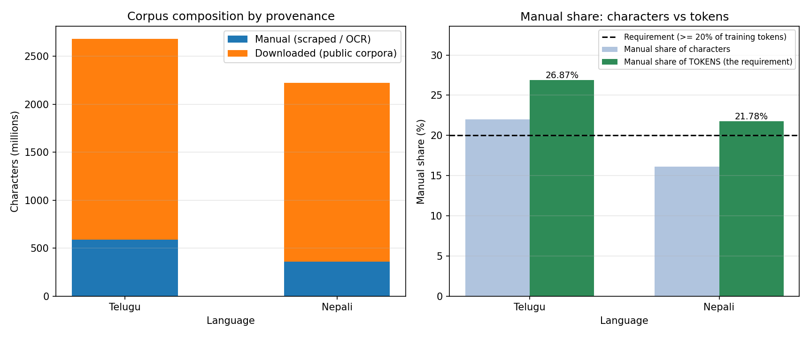

# Phase 1 — Data Collection and Tokenization

**Language Models and Agents, Monsoon 2026 — Individual Project**
Model H = Telugu · Model L = Nepali

> **Status of the numbers in this document.** Every figure below is measured
> unless it is explicitly labelled a projection. Measured values come from
> `report/phase1/stats/*_clean_stats.json` and `report/phase1/stats/*_token_counts.json`,
> which are committed alongside this report. Where a projection appears it is
> marked as one, and §9 is a dedicated account of where the projections were
> wrong and why. One statistic — the Telugu per-reason rejection breakdown — was
> lost to a crash and is reported as unavailable rather than reconstructed;
> see §9.1.

---

## 1. Summary

Two independent monolingual corpora were collected, cleaned, deduplicated,
split, and tokenized with from-scratch BPE vocabularies.

| | Model H — Telugu | Model L — Nepali |
|---|---|---|
| Script | Telugu (Brahmic) | Devanagari |
| Resource tier | Higher | Lower (from allowed list) |
| **Total tokens** | **674,176,616** | **511,303,554** |
| **Training tokens** | **666,507,564** | **501,331,128** |
| **Manual token share (train)** | **26.87%** ✅ | **21.78%** ✅ |
| Manual character share | 22.00% | 16.13% |
| Vocabulary size | 16,000 | 16,000 |
| Documents after cleaning | 3,139,945 | 2,152,701 |
| Characters after cleaning | 2,679,035,867 | 2,220,405,505 |
| UTF-8 bytes | 7,146,905,162 | 5,917,382,353 |
| Characters per token | 3.9738 | 4.3426 |
| Bytes per token (train) | 10.6046 | 11.5743 |
| Train / val / test | 0.98 / 0.01 / 0.01 | 0.98 / 0.01 / 0.01 |
| Split seed | 1337 | 2718 |

Both models exceed the ~500M token target and both clear the ≥20% manual
requirement, which is stated in the spec in **tokens** and is therefore measured
in tokens here.

Nothing is shared between the two: separate corpora, separate tokenizers,
separate vocabularies, separate output directories. `common/` holds pipeline
*logic* only; each language invokes it with its own YAML config and writes to
its own tree.

---

## 2. Language selection

**Telugu** as the higher-resource model: ~83M speakers, ~31M documents in
AI4Bharat IndicCorpV2, coverage in Sangraha, a large Wikipedia, and a dense
news ecosystem across Andhra Pradesh and Telangana.

**Nepali** as the lower-resource model. It is on the assignment's allowed list
and is by a wide margin the best-resourced option on it: ~36.5M documents in
IndicCorpV2 against 3.38M for the runner-up (Assamese) and under 1M for most
others. Combined with IRIISNEPAL/Nepali-Text-Corpus (6.4M docs / 27.5GB) it was
the only allowed-list language where ~500M tokens looked reachable at all.

The pair is deliberately chosen so the two scripts differ in a way that changes
the *pipeline*, not just the data — see §5.

---

## 3. Collection

### 3.1 Sources

| Language | Downloaded | Manually collected |
|---|---|---|
| Telugu | IndicCorpV2 (`data/te.txt`), Sangraha (verified/tel), Wikipedia te | Own crawl of Telugu news outlets; archive.org public-domain books |
| Nepali | IRIISNEPAL/Nepali-Text-Corpus, IndicCorpV2 (`data/ne.txt`), Sakonii/nepalitext, Wikipedia ne | Own crawl of Nepali news outlets; archive.org public-domain books |

Every record carries a `provenance` field written at ingestion time
(`manual_scrape` or `downloaded`), so the manual/downloaded split in every
statistic below is **computed from the data, not asserted**. The split is
re-counted a second time during tokenization, inside the single pass that
`common/encode_corpus.py` already makes over the corpus, so the reported token
share is derived from the same documents that were actually encoded. Any record
with a missing or malformed provenance tag is counted as *downloaded*, which
means the reported manual share can only ever be an underestimate.

Crawling is sitemap-driven, resumable through a per-site SQLite state database,
and rate-limited. `robots.txt` is fetched and honoured before any crawl begins.

### 3.2 Archive.org metadata was hiding an order of magnitude of data

The single highest-leverage finding in Phase 1, and it is about search
strategy, not about books.

| Query | Items returned |
|---|---|
| `language:("Nepali")` | 240 |
| `language:("nep")` | 1,627 (**7.8×**) |
| subject + collection queries | 10,011 further items |

The subject and collection queries reach volumes whose `language` metadata
field is simply **blank** — invisible to any language-filtered search, however
the alias is spelled. For contrast, over the same period **36 additional Nepali
news sources were onboarded and yielded 10M characters**, against **214M
characters from widening the alias search alone**.

That ratio is visible in the final corpus. Of 64,362 surviving Nepali manual
documents, **37,733 are archive.org books** and 23,707 come from `nepalpress`,
the one news source that produced at scale before blocking the crawler; the
remaining seventeen news sources contribute **2,922 documents between them**.

The lesson generalizes: for a lower-resource language, the constraint is
usually not that the text does not exist, but that its metadata does not
describe it. Effort spent interrogating a catalogue's indexing beat effort
spent adding crawl targets by more than an order of magnitude.

### 3.3 Nepali source attrition

Of 56 candidate Nepali news sources:

- several disallowed crawling in `robots.txt` (~380,000 URLs across 3 sites)
- 4 returned 403/429 on `robots.txt` itself
- 5 published no sitemap
- `nepalpress` IP-blocked the crawler after ~12 hours and 24,182 pages

**The block was respected, not circumvented.** No proxy rotation, no user-agent
spoofing, no retry against the block. The resulting shortfall is reported here
rather than engineered away, which is the correct trade even though it cost the
project a source.

This attrition is the reason the Nepali manual share had to come from books
rather than news, which in turn is what made §3.2 matter — and, through §9.2,
why Nepali manual text survives cleaning at a far lower rate than Telugu's.

---

## 4. Cleaning pipeline

One streaming pass, `common/clean_pipeline.py`:

```
raw → normalize → filter → exact dedup → langid → near dedup → split
                                                                  ↓
                                                        tokenize → encode
```

Two ordering decisions worth stating:

- **Dedup precedes splitting.** Deduplicating after the split would leave
  near-duplicate pairs straddling train and test, inflating held-out
  performance without any error being visible.
- **Splits are document-level, never line-level.** Splitting by line puts
  sentences from the same article on both sides of the boundary, which leaks
  badly for exactly the same reason.

Split assignment hashes the document id salted with the language seed, so it is
deterministic, needs no shuffle or second pass, and stays stable as the corpus
grows. Held-out sets are capped at 20,000 documents each; the overflow goes to
train rather than being discarded, which is why the realised split is 98.7/0.6/0.6
for Telugu rather than exactly 98/1/1.

### 4.1 Filters

| Filter | Telugu | Nepali |
|---|---|---|
| `min_script_ratio` | 0.80 | 0.80 |
| `min_langid_confidence` | 0.60 | **0.70** |
| `min_chars` / `max_chars` | 200 / 50,000 | 200 / 50,000 |
| `min` / `max_mean_word_len` | 2.0 / 30.0 | 2.0 / 30.0 |
| `max_dup_line_fraction` | 0.30 | 0.30 |
| `max_short_line_fraction` | 0.80 | 0.80 |
| `max_downloaded_to_manual_ratio` | 4.5 | 5.2 |

Filters are ordered cheapest-first: length, then script ratio, then structural
quality heuristics, then a 64-bit exact-duplicate hash, then fastText language
ID, then MinHash near-duplicate detection. Language ID runs late deliberately —
it is the most expensive test, and by that point the cheap filters have already
removed most of the junk it would otherwise have to classify.

### 4.2 Near-duplicate detection

MinHash LSH with `num_perm: 64` and explicit band parameters `(b=6, r=10)`.
The `minhash_threshold: 0.80` in both YAML files is **documentation only** — the
pipeline passes `params=(6, 10)` directly rather than letting datasketch derive
bands from a threshold, so the recall curve is controlled explicitly.

These parameters are a memory result, not a quality preference. At 128
permutations with datasketch's derived banding, the index stores one hashtable
entry per band per kept document — roughly 50M entries at 32 bands — and OOMs a
12GB Colab instance.

**Near-duplicate detection is applied to manually collected text only, and this
is a real limitation rather than a considered filter design.** The reasoning
is that IndicCorpV2 and Sangraha are deduplicated upstream by AI4Bharat, and
syndication — the duplication mode near-dedup exists to catch — is a property of
our own news crawl. Exact deduplication (a 64-bit BLAKE2b hash of the normalized
text) still runs across the *whole* corpus and catches verbatim overlap between
the two halves.

The limitation bites hardest for Nepali, where `iriisnepal_corpus`, `nepalitext`
and `indiccorp_v2_ne` are three independent crawls of the same Nepali web.
Cross-source *near*-duplicates between them survive with only exact-hash
deduplication between them. This shows in the funnel: only **1,662** Nepali
documents were removed as near-duplicates against **872,618** removed as exact
duplicates. The honest reading is not "there were few near-duplicates" but
"near-duplicates were only looked for in 3% of the corpus". Running LSH over the
downloaded half is the correct fix and was not affordable in the available
memory.

---

## 5. The same pipeline, a different load-bearing filter

This is the clearest empirical contrast between the two languages, and it is
not one that shows up in a token count.

**Nepali script filtering does almost none of the work.** Devanagari is shared
with Hindi, Marathi, Sanskrit, Newari and others, all of which score ~1.0 on a
Devanagari script-ratio test. In the final Nepali run, fastText language ID
rejected:

| Rejected as | Documents |
|---|---|
| Hindi (`hi`) | 14,195 |
| Sanskrit (`sa`) | 11,775 |
| below the 0.70 confidence floor | 11,369 |
| Marathi (`mr`) | 947 |
| Newari (`new`) | 826 |
| English (`en`) | 62 |
| Danish (`da`) | 49 |
| Russian (`ru`) | 12 |
| Hungarian, Maithili, Khmer, Konkani, Czech, Korean, Macedonian | 16 combined |
| **Total language-ID rejections** | **39,251** |

Against this, the Devanagari **script-ratio** filter rejected **8,755** documents
— and those are almost entirely Latin-script contamination, not competing
Indic languages.

**Language ID rejected 4.5× more documents than script filtering, and every one
of those 39,251 would have passed a script-ratio check.** This is why the Nepali
confidence floor is set at 0.70 against Telugu's 0.60: for any given Devanagari
document, Hindi is a plausible competing hypothesis, and admitting
confident-looking Hindi would make Model L covertly bilingual — violating the
spec's hard monolingual constraint and confounding the Phase 3 resource-tier
analysis. Discarding borderline genuine Nepali is the cheaper error.

**Telugu script filtering does nearly all of the work**, because the Telugu
script is used to write essentially one language and a script-ratio test alone
removes nearly all contamination. Two caveats are owed here rather than a clean
comparative statistic:

1. The Telugu run **skips language ID on downloaded shards entirely** — a
   deliberate optimization, since `wrong_script` already rejects non-Telugu text
   and fastText on every document is pure overhead. Any Telugu language-ID count
   is therefore measured on the manual subset, not on the corpus.
2. The Telugu per-reason rejection counters were **lost when that run crashed**
   before writing its statistics file (§9.1). The kept-side numbers were
   recovered exactly; the rejection breakdown was not.

So the correct claim is structural, not numerical: **Telugu's script filter is
sufficient and its language-ID filter is redundant; Nepali's script filter is
insufficient and its language-ID filter is load-bearing.** The Nepali column of
this table is the evidence; the Telugu column is an argument from the writing
system, and the run that would have quantified it did not survive.

### 5.1 The mirror-image case: `greatandhra`

The Telugu crawl collected 48,612 documents from `greatandhra`, which turned
out to **publish in English**. Median Telugu-script ratio: **0.00**. Recoverable
fraction even at a relaxed 0.60 threshold: **0%**.

All 48,612 documents were rejected — 127.6M characters, roughly 14% of raw
manual collection, discarded. `greatandhra` appears nowhere in the final source
table (§7.1), which is the audit trail for that rejection. Admitting them would
have made Model H covertly bilingual in exactly the way the Nepali filter exists
to prevent. Two languages, opposite failure modes, same underlying requirement.

### 5.2 Shard ordering is not neutral

The ratio cap (§8) stops consuming downloaded text once the budget is spent. The
first Nepali run processed shards in `sorted()` order and produced this:

```
budget spent — skipping shard nepalitext-00009 … 00013
budget spent — skipping shard wikipedia_ne-00000
budget spent — skipping shard wikipedia_ne-00001
```

**Nepali Wikipedia was excluded from the corpus in its entirety** — both shards —
because `w` sorts after `i` and `n`. The corpus composition was decided by
filename collation rather than by any judgement about source quality, and
Wikipedia is arguably the highest-quality Nepali source available.

The fix is to interleave downloaded shards across sources round-robin, so that
when the cap binds the truncation falls **proportionally** on every source
instead of wholly on whichever sorts last. After the change, the skipped shards
were `indiccorp_v2_ne-00047 … 00057` — the cut now lands on the **largest**
source, where losing 11 shards of 908,703 surviving documents costs the least
diversity, and Wikipedia contributes 19,412 documents to the final corpus.

The same effect was present in the Telugu run and went unnoticed there only
because supply ran out before the cap bound, so every source was reached.
A budget cap and an ordered work list interact whether or not anyone intends
them to.

---

## 6. Tokenization

Both tokenizers are SentencePiece BPE trained from scratch. No pretrained
tokenizer, no shared vocabulary, no shared training text.

Settings: `character_coverage: 0.9995`, `split_digits: true`,
`byte_fallback: true` (guaranteeing zero UNK at inference), specials
`<pad> <unk> <s> </s>`. Each sweep trains on a ~400MB sample of that language's
own `train.jsonl` and evaluates on 5,000 held-out documents from the same
language.

### 6.1 The sweep, and why its selection was overridden

| Telugu | fertility | chars/token | UNK rate | embedding params |
|---|---|---|---|---|
| 8,000 | 2.2855 | 3.470 | 0.00e+00 | 3.07M |
| **16,000** | **2.0347** | **3.898** | **0.00e+00** | **6.14M** |
| 24,000 | 1.9194 | 4.132 | 0.00e+00 | 9.22M |
| 32,000 | 1.8490 | 4.289 | 0.00e+00 | 12.29M |

| Nepali | fertility | chars/token | UNK rate | embedding params |
|---|---|---|---|---|
| 8,000 | 1.6619 | 3.907 | 0.00e+00 | 3.07M |
| **16,000** | **1.4839** | **4.375** | **0.00e+00** | **6.14M** |
| 24,000 | 1.4103 | 4.604 | 0.00e+00 | 9.22M |
| 32,000 | 1.3678 | 4.747 | 0.00e+00 | 12.29M |

The spec asks for a vocabulary "in the tens of thousands", chosen "using
fertility / unknown-token rate on held-out text". Applied literally, that
criterion cannot select anything but the largest candidate offered, for two
reasons that the tables above make plain:

- **The UNK rate is identically 0.00 at every vocabulary size**, because
  `byte_fallback: true` means the model cannot emit UNK — any unseen sequence
  falls back to bytes. Half the stated criterion carries no information and
  cannot break a tie.
- **Fertility falls monotonically with vocabulary size.** There is no interior
  optimum for a tolerance-based rule to find.

The sweep duly selected **32,000** for both languages. That selection was
**overridden to 16,000**, and the reason belongs in the report rather than in a
commit message.

Phase 2 fixes the model at ~25M parameters with the input embedding tied to the
output head. At `d_model = 384`:

| Vocabulary | Embedding params | Share of a ~25M budget | Params left for layers | ≈ transformer blocks |
|---|---|---|---|---|
| 32,000 | 12.29M | **49%** | ~12.7M | ~7 |
| 16,000 | 6.14M | **25%** | ~18.9M | ~11 |

Spending half of a small model's capacity on a lookup table buys a 10%
fertility improvement (Telugu 2.035 → 1.849). Four additional transformer
blocks is the better use of the same parameters. The smaller vocabulary also
yields *more* training tokens from the same text, which helps rather than hurts
the 500M target.

This is still selection on fertility, as the spec asks — it is selection on
**fertility per parameter spent** rather than fertility alone. `scripts/reselect.py`
applies the override, deletes the superseded 32,000 artifacts so the committed
tokenizer directory is unambiguous, and writes the full argument into
`tokenizer_sweep.json` as a `selection_note` so the decision is auditable rather
than silent.

### 6.2 Token counts are tokenizer-dependent

The same Telugu corpus of 2,679,035,867 characters, unchanged, yields:

| Vocabulary | Tokens |
|---|---|
| 8,000 | ~772M (derived from held-out chars/token) |
| **16,000** | **674,176,616 (measured)** |
| 24,000 | ~648M (derived) |
| 32,000 | ~625M (derived) |

A **~24% swing** in the headline "corpus size" from a hyperparameter that has
nothing to do with how much text was collected. **The vocabulary was chosen on
model-design grounds and the token count is a consequence, not the objective.**
Stating this explicitly seems better than leaving a reader to wonder how the
number landed where it did.

It also means "500M tokens" is only meaningful alongside the tokenizer that
produced it. Both `token_counts.json` files record `tokenizer_model` for exactly
this reason.

### 6.3 Measured characters per token

Computed from `chars_per_provenance` in the cleaning statistics against
`tokens_per_provenance` in the encoding statistics — same documents, both ends:

| | manual | downloaded | overall |
|---|---|---|---|
| Telugu | **3.225** | 4.252 | 3.974 |
| Nepali | **3.211** | 4.658 | 4.343 |

**Manually collected text tokenizes denser than downloaded text in both
languages**, and by a similar margin. News prose and OCR'd book text have a
different subword profile than bulk web crawl — more running prose, less
boilerplate, markup and URL residue.

Two things are worth noticing. First, the manual figures are nearly identical
across two unrelated writing systems (3.225 vs 3.211), while the downloaded
figures differ substantially (4.252 vs 4.658) — the collection *method* appears
to shape the subword profile more than the language does. Second, this has a
direct compliance consequence: the manual **token** share always comes out
*above* the manual **character** share.

| | manual char share | manual token share |
|---|---|---|
| Telugu | 22.00% | **26.87%** |
| Nepali | 16.13% | **21.78%** |

The gap is not cosmetic. The cleaning stage enforces the provenance ratio on
**characters**, because it runs before any tokenizer exists; the spec states the
requirement in **tokens**. For Nepali the two land on opposite sides of the
threshold — 16.13% of characters, 21.78% of tokens — so testing the wrong one
reports failure on a corpus that passes. `common/encode_corpus.py` computes the
token share and `scripts/build_phase1_report.py` gates on it.

### 6.4 Token-frequency statistics

Counted with `scripts/token_stats.py` over the encoded `train.bin` — the exact
`uint16` stream Phase 2 will sample from — rather than over a re-tokenization of
the text, so the frequencies describe the tokens the model actually sees.

| | Telugu | Nepali |
|---|---|---|
| Vocabulary size | 16,000 | 16,000 |
| Training tokens counted | 666,507,564 | 501,331,128 |
| Distinct pieces used | 15,872 | 15,892 |
| **Pieces never used** | **128 (0.80%)** | **108 (0.68%)** |
| Pieces used exactly once | 0 | 2 |
| **UNK occurrences** | **0** | **0** |
| UNK rate | 0.00e+00 | 0.00e+00 |

**Over 99.2% of both vocabularies is used, and neither has a meaningful dead
tail** — Telugu has no pieces occurring exactly once in 666M tokens, Nepali has
two. This is direct evidence for the §6.1 decision: at 16,000 essentially every
embedding row earns its parameters. A vocabulary chosen for fertility alone
would have to defend the utilization of the pieces it adds, not merely their
effect on the average.

The UNK rate is 0 as *measured*, not merely as configured. `byte_fallback: true`
means the tokenizer cannot emit UNK — and §6.5 shows the fallback firing in
practice, so this is a working mechanism rather than a vacuous guarantee.

**Cumulative coverage by the most frequent pieces:**

| Top *N* pieces | Telugu | Nepali |
|---|---|---|
| 10 | 13.63% | 12.39% |
| 100 | 27.63% | 28.00% |
| 500 | 46.27% | 46.64% |
| 1,000 | 56.64% | 57.36% |
| 5,000 | 82.91% | 84.35% |
| 10,000 | 93.91% | 94.80% |

The two curves are nearly identical despite unrelated languages, writing systems
and corpora — the shape is a property of BPE at a fixed vocabulary size more
than of the language. The last 6,000 pieces carry ~6% of occurrences in both.




**Fifteen most frequent pieces per language:**

| Rank | Telugu piece | Count | Share | | Nepali piece | Count | Share |
|---|---|---|---|---|---|---|---|
| 1 | `.` | 30,748,048 | 4.613% | | `▁।` | 14,475,672 | 2.887% |
| 2 | `,` | 15,368,360 | 2.306% | | `,` | 9,475,406 | 1.890% |
| 3 | `<0x0A>` | 14,926,692 | 2.240% | | `<0x0A>` | 9,147,355 | 1.825% |
| 4 | `▁` | 8,035,382 | 1.206% | | `▁र` | 6,136,160 | 1.224% |
| 5 | `1` | 4,388,259 | 0.658% | | `▁छ` | 5,760,008 | 1.149% |
| 6 | `0` | 4,072,102 | 0.611% | | `।` | 5,502,749 | 1.098% |
| 7 | `▁ఈ` | 3,839,203 | 0.576% | | `को` | 3,273,850 | 0.653% |
| 8 | `2` | 3,246,343 | 0.487% | | `▁पनि` | 2,843,815 | 0.567% |
| 9 | `<s>` | 3,099,947 | 0.465% | | `का` | 2,781,452 | 0.555% |
| 10 | `</s>` | 3,099,947 | 0.465% | | `मा` | 2,725,357 | 0.544% |
| 11 | `లో` | 2,556,339 | 0.384% | | `ले` | 2,552,276 | 0.509% |
| 12 | `ను` | 2,167,714 | 0.325% | | `लाई` | 2,251,497 | 0.449% |
| 13 | `5` | 2,073,002 | 0.311% | | `<s>` | 2,112,701 | 0.421% |
| 14 | `లు` | 2,036,811 | 0.306% | | `</s>` | 2,112,701 | 0.421% |
| 15 | `..` | 1,999,113 | 0.300% | | `▁भएको` | 2,089,386 | 0.417% |

An integrity check falls out of this table for free: `<s>` and `</s>` occur
**3,099,947** times in Telugu and **2,112,701** times in Nepali, exactly matching
the training document counts in §7.1 and §7.2. Every document was wrapped
exactly once, and the frequency count and the split statistics were produced by
independent passes.

**The two head distributions differ in kind, not just in detail.** Thirteen of
Telugu's top thirty pieces are punctuation or digits — seven are single digits —
and the first piece of actual Telugu script appears only at **rank 7**. For
Nepali, nine of the top thirty are non-lexical and the first Devanagari piece is
at **rank 4**, with the rest of the head made of genuine high-frequency
morphemes (`▁र` "and", `▁छ` "is", `▁पनि` "also", `▁लागि` "for", `▁भएको` "having
been").

This follows from the fertility gap in §6.1. Telugu is more agglutinative, so at
a fixed 16,000-piece budget BPE spends its vocabulary on word-internal fragments
(`లో`, `ను`, `లు`, `కి` — case and postpositional suffixes) rather than on whole
words, and Telugu fertility is correspondingly higher (2.035 against Nepali's
1.484). When word-level pieces are rarer, punctuation rises to the top of the
frequency list by default. Nepali's most frequent piece is `▁।`, the danda,
which is simply its sentence terminator — the same structural role Telugu's `.`
plays at rank 1.

### 6.5 Tokenization examples

Decoded back out of `train.bin`, so these are demonstrably what was encoded
rather than a fresh tokenization of a favourably chosen sentence. Fertility is
quoted for the whole document; the excerpt is its first 40 tokens.

**Telugu** — a news article, 574 words → 1,162 tokens, fertility 2.024:

```
text    Income Tax Refund : మీ ITR రీఫండ్ రాలేదా? ఆన్‌లైన్‌లో టాక్స్ పేయర్లు చేసే తప్పులివే..
pieces  ▁In com e ▁T a <0x78> ▁Re f un d ▁: ▁మీ ▁I T R ▁రీ ఫ ండ్ ▁రాలే దా ?
        ▁ఆన్లైన్లో ▁టా క్స్ ▁పే యర్లు ▁చేసే ▁తప్పు లి వే ..
```

Two things are visible here. First, **`<0x78>` is byte fallback firing** — the
Latin letter `x` in "Tax" is not a vocabulary piece, so it is emitted as its raw
UTF-8 byte. This is why the UNK count in §6.4 is 0 rather than merely small, and
it is the mechanism working on real input rather than in principle.

Second, the document contains English. This is **code-mixing in the source, not
contamination**: Telugu news routinely carries English headline keywords and
proper nouns inside otherwise Telugu prose. The `min_script_ratio: 0.80` filter
admits documents where up to 20% of *letters* are outside the target script,
which is deliberate — a stricter threshold would reject genuine Telugu
journalism for quoting a scheme name. It is a different case from `greatandhra`
(§5.1), where the median Telugu-script ratio was 0.00 and the documents were
English with no Telugu content at all.

**Nepali** — a dictionary entry from an archive.org volume, 1,215 words → 3,029
tokens, fertility 2.493:

```
text    भन्सार गोदाम- ना: भन्सारमा रहन आएका जिन्सी सामानहरूलाई थान्को लाउन बनाइएको घर।
pieces  ▁भन्सार ▁गोदा म - ▁ना : ▁भन्सार मा ▁रहन ▁आएका ▁जि न् सी ▁सामान हरूलाई
        <0x0A> था न् को ▁ला उन ▁बनाइएको ▁घर ।
```

All three sampled Nepali documents came from the same lexicographic volume,
which is itself informative: §3.2 explains why archive.org books dominate the
Nepali manual half, and this is what that looks like at the level of individual
documents. Their fertility (2.49–2.59) is far above the corpus average of 1.484,
because dictionary text is a dense sequence of rare headwords and abbreviations
rather than running prose — exactly the material a BPE vocabulary trained mostly
on news and web text has no whole-word pieces for. `▁सामान हरूलाई` shows the
expected agglutinative split: stem plus the plural-dative suffix `हरूलाई`.


---

## 7. Corpus statistics

### 7.1 Telugu (Model H)

| Metric | Value |
|---|---|
| Documents read | ≥ 6,900,000 (lower bound — see §9.1) |
| Documents kept | 3,139,945 |
| Keep rate | ≤ 45.5% (upper bound, inherits the above) |
| Characters after cleaning | 2,679,035,867 |
| UTF-8 bytes | 7,146,905,162 |
| Manual characters | 589,327,781 (22.00%) |
| Downloaded characters | 2,089,708,086 |
| **Total tokens** | **674,176,616** |
| **Training tokens** | **666,507,564** |
| **Manual training tokens** | **179,057,619 (26.87%)** |
| Downloaded training tokens | 487,449,945 |
| Per-reason rejection counts | **unavailable — see §9.1** |

**Splits** (document-level, seed 1337):

| Split | Documents | Tokens | Characters | chars/token | bytes/token |
|---|---|---|---|---|---|
| train | 3,099,947 | 666,507,564 | 2,649,468,357 | 3.975 | 10.605 |
| validation | 19,998 | 3,766,723 | 14,569,901 | 3.868 | 10.322 |
| test | 20,000 | 3,902,329 | 14,997,609 | 3.843 | 10.249 |

**Documents per source** (13 sources; `greatandhra` absent by rejection, §5.1):

| Source | Documents | Provenance |
|---|---|---|
| indiccorp_v2_te | 2,558,275 | downloaded |
| sangraha_te | 337,524 | downloaded |
| v6velugu | 117,237 | manual |
| archive_org_books | 39,339 | manual |
| wikipedia_te | 38,023 | downloaded |
| prabhanews | 33,436 | manual |
| 10tv | 11,000 | manual |
| sakshi | 1,358 | manual |
| andhrajyothy | 1,207 | manual |
| ntnews | 955 | manual |
| tv9telugu | 850 | manual |
| ntvtelugu | 543 | manual |
| telugu_samayam | 198 | manual |

Manual total 206,123 documents; downloaded total 2,933,822.

### 7.2 Nepali (Model L)

| Metric | Value |
|---|---|
| Documents read | 4,053,265 |
| Documents kept | 2,152,701 |
| Keep rate | 53.11% |
| Characters after cleaning | 2,220,405,505 |
| UTF-8 bytes | 5,917,382,353 |
| Manual characters | 358,129,769 (16.13%) |
| Downloaded characters | 1,862,275,736 |
| **Total tokens** | **511,303,554** |
| **Training tokens** | **501,331,128** |
| **Manual training tokens** | **109,203,423 (21.78%)** |
| Downloaded training tokens | 392,127,705 |
| Elapsed cleaning time | 4,597.5 s |

**Splits** (document-level, seed 2718):

| Split | Documents | Tokens | Characters | chars/token | bytes/token |
|---|---|---|---|---|---|
| train | 2,112,701 | 501,331,128 | 2,177,294,897 | 4.343 | 11.574 |
| validation | 20,000 | 4,970,840 | 21,496,549 | 4.325 | 11.519 |
| test | 20,000 | 5,001,586 | 21,614,059 | 4.321 | 11.512 |

**Cleaning funnel** — 4,053,265 read, 2,152,701 kept (53.11%):

| Rejection reason | Documents | % of read |
|---|---|---|
| too_short | 943,796 | 23.28% |
| exact_duplicate | 872,618 | 21.53% |
| downloaded_over_ratio_budget | 24,541 | 0.61% |
| langid: Hindi | 14,195 | 0.35% |
| langid: Sanskrit | 11,775 | 0.29% |
| langid: low confidence | 11,369 | 0.28% |
| wrong_script | 8,755 | 0.22% |
| mostly_short_lines | 8,362 | 0.21% |
| near_duplicate | 1,662 | 0.04% |
| repeated_lines_boilerplate | 1,539 | 0.04% |
| langid: Marathi | 947 | 0.02% |
| langid: Newari | 826 | 0.02% |
| langid: other (en/da/ru/hu/mai/km/gom/cs/ko/mk) | 139 | 0.00% |
| too_long_listing_page | 20 | 0.00% |
| bad_mean_word_length | 18 | 0.00% |
| empty_after_normalization | 2 | 0.00% |
| *shards skipped over budget* | *11 shards* | — |



*Rejection reasons as a share of documents read. Only Nepali is plotted: the
Telugu per-reason counters were lost (§9.1).*

Note that shard-level and document-level budget rejections are counted under
**separate keys**. They were previously incremented into the same counter,
which silently mixed a count of files with a count of documents and made this
table meaningless.

**Documents per source** (19 sources):

| Source | Documents | Provenance |
|---|---|---|
| indiccorp_v2_ne | 908,703 | downloaded |
| iriisnepal_corpus | 718,907 | downloaded |
| nepalitext | 441,317 | downloaded |
| archive_org_books | 37,733 | manual |
| nepalpress | 23,707 | manual |
| wikipedia_ne | 19,412 | downloaded |
| karobardaily | 2,579 | manual |
| mofa_gov | 103 | manual |
| bbc_nepali | 85 | manual |
| nagariknews | 60 | manual |
| nepalipatra | 49 | manual |
| thahakhabar | 13 | manual |
| opmcm_gov | 8 | manual |
| himalkhabar | 7 | manual |
| moest_gov | 6 | manual |
| nepalsamaya | 5 | manual |
| lawcommission | 4 | manual |
| baahrakhari | 2 | manual |
| setopati | 1 | manual |

Manual total 64,362 documents; downloaded total 2,088,339. The long tail of
single-digit news sources is the visible residue of §3.3 — sites that were
reachable and permitted, but from which the crawl recovered almost nothing
before the collection window closed.



---

## 8. The 20% rule is a ceiling, not only a floor

The requirement "≥20% of final training tokens must be manually collected" is
usually read as a floor to clear. Operationally it behaves as a **ceiling on
total corpus size**:

$$\text{total\_tokens} \le \frac{\text{manual\_tokens}}{0.20}$$

Once manual collection is fixed, no amount of additional downloaded text raises
the token count — the cleaner discards the surplus to hold the ratio. The
cleaner enforces this as a character-ratio cap `max_downloaded_to_manual_ratio`
(**4.5** Telugu, **5.2** Nepali), applied to characters even though the
requirement is stated in tokens, because the cap must be evaluated before any
tokenizer exists.

With the measured per-provenance rates from §6.3, the character ratio $R$ that
corresponds to a token share $s$ is:

$$s = \frac{1/c_m}{1/c_m + R/c_d}$$

* $c_m$ = manual chars/token
* $c_d$ = downloaded chars/token

For Nepali ($c_m = 3.211$, $c_d = 4.658$), $R = 5.2$ gives $s = 21.8\%$ — which
is what was measured. The equivalent ceiling, the $R$ at which $s$ would fall to
exactly 20%, is $R = 5.80$. Telugu's $R = 4.5$ sits even further inside its own
ceiling of $R = 5.27$.



*Left: corpus composition in characters. Right: the manual share measured both
ways against the requirement. The gate follows the token bars, because that is
how the spec states the rule — Nepali passes at 21.78% in tokens while sitting
at 16.13% in characters.*

The practical consequence, which governed the second half of Phase 1: **once the
cap binds, only more manual data raises the ceiling, and every additional
downloaded character is collected, cleaned, and then thrown away.** For Nepali
the cap did bind — 24,541 documents and 11 whole shards were cleaned or skipped
under it. Budgets in both downloaders are sized to reach the cap and stop, and
the reasoning is recorded in the module docstrings so the next person does not
"helpfully" raise them.

### 8.1 Choosing the Nepali ratio

The ratio is the one free parameter that trades the two requirements against
each other, and both were tested against real runs rather than argued about:

| Ratio | Total tokens | Manual token share | Wikipedia included |
|---|---|---|---|
| 5.0 | 493,855,360 | 22.55% | **no** |
| **5.2** | **511,303,554** | **21.78%** | **yes** |

The asymmetry decides it. A shortfall against ~500M tokens is explicitly
survivable for the lower-resource language — the spec permits reporting the
exact count and justifying it. **Falling below 20% manual is not survivable for
either language and has no such clause.** So the ratio was raised only as far as
it needed to go to clear 500M with the cap no longer excluding an entire source,
and no further: 5.2 keeps 1.78 percentage points of margin on the unforgiving
constraint while clearing the forgiving one outright.

---

## 9. What the estimates got wrong

A section on this seems more useful than quietly correcting the numbers.

### 9.1 A four-hour run that reported success and wrote nothing

The Telugu cleaning pass terminated before writing `clean_stats.json`. Every
corpus statistic for Model H was lost with the process — after four hours of
work — and the failure was invisible in three separate ways at once:

- `CorpusCleaner.run` wrote its statistics file **after** its
  `try/except/finally` block. The `finally` closed the three split writers, so
  `train.jsonl`, `validation.jsonl` and `test.jsonl` were complete, correct, and
  perfectly usable on disk. Only the accounting was missing.
- The command was piped through `tee`, so the shell's `&&` tested **tee's** exit
  status, not Python's. The follow-on `tar` ran happily over a directory with no
  statistics file in it.
- `tee` was writing to a Google Drive FUSE mount. The most probable trigger is
  that the Drive write failed during the run and broke the pipe — in which case
  the traceback was lost because the log *was* the thing that failed.

The evidence for a clean exception rather than an OOM kill: recovery found
**zero truncated lines**. A `SIGKILL` loses the userspace buffer and leaves one
partial JSON line; a `finally` that closes the writers does not.

**Recovered:** `scripts/rebuild_clean_stats.py` recomputes every kept-side
statistic by streaming the written splits — document counts, characters, bytes,
per-source and per-provenance breakdowns, split sizes. These are exact, because
they are properties of the documents themselves.

**Not recovered:** the per-reason rejection counters existed only in memory.
`rejected_by_reason` is emitted **empty and flagged** rather than filled with
zeros, and `documents_read` is taken from the last progress line in the run log,
making it a lower bound and `keep_rate` an upper bound. The reconstructed file
carries a `reconstructed: true` flag and a note recording all of this.

The fix: statistics are now written inside `finally`, so a multi-hour job
persists its accounting on **every** exit path, and long runs `tee` to local
disk and copy to Drive afterwards. The Nepali funnel in §7.2 exists because of
that change.

### 9.2 Manual survival through cleaning is language-specific, and the assumption was wrong twice

Planning assumed 75–80% of manual characters would survive cleaning. Measured:

| | manual raw (usable) | → clean | survival |
|---|---|---|---|
| Telugu | 786.7M | 589.3M | **74.9%** |
| Nepali | ~677.5M | 358.1M | **52.9%** |

The Telugu assumption was right. The Nepali one was wrong by 22 percentage
points, and the difference is explained by composition, not by the pipeline:
Telugu's manual half is 167,000 news documents against 39,000 books, while
Nepali's is 37,733 books against 26,600 news documents. **OCR'd book text loses
heavily to `min_chars`, `max_dup_line_fraction` and `max_short_line_fraction`** —
running headers, page furniture, hyphenation artifacts, short fragments — where
news prose sails through.

An intermediate estimate of 51% for Nepali, back-solved from an earlier
completed pass, was dismissed at the time as unreliable because it disagreed
with Telugu's measured 74.9%. It turned out to be accurate to within two points.
The mistake was treating one language's measurement as a constant of the
pipeline rather than a property of that language's source mix.

### 9.3 Characters per token

Planning used 3.2 characters per token throughout. Measured values are
3.21–4.66 depending on language *and* provenance (§6.3). Every pre-tokenization
estimate in this project was therefore up to ~40% too high, including a
"SHORT / ON TARGET" verdict in `scripts/check_target.py` that was wrong in both
directions at different times. That tool now uses per-language, per-provenance
measured constants and applies the ratio cap.

**The general lesson: a derived constant used for planning must be measured
against a completed run before it is trusted, and until then every downstream
number inherits its error silently.** Only `token_counts.json` is authoritative,
and only for the tokenizer it names.

---

## 10. Reproducibility

- All configuration lives in `telugu/configs/telugu.yaml` and
  `nepali/configs/nepali.yaml`; no thresholds are hard-coded in pipeline logic.
  The committed `max_downloaded_to_manual_ratio` values (4.5 / 5.2) are the ones
  that produced the corpora described here.
- All randomness is seeded. Split seeds are deliberately different between the
  languages (1337 / 2718) so the independence of the two splits is visible at a
  glance rather than asserted.
- Split assignment is a hash of the document id, not a shuffle, so it is stable
  under corpus growth and reproducible without holding the corpus in memory.
- Raw corpora and tokenized binaries are **not** committed — Telugu's
  `train.bin` alone is 1.3GB against GitHub's 100MB per-file limit. What *is*
  committed: every script needed to regenerate them, the cleaning and token
  statistics under `report/phase1/stats/`, and both tokenizer `.model`/`.vocab`
  files.
- Large artifacts are linked from the README's Drive table with open
  permissions.

### 10.1 Figures

All five are committed under `report/phase1/figures/` and referenced above; none
requires opening Drive to view.

| Figure | Section |
|---|---|
| `provenance_split.png` | §8 |
| `cleaning_funnel.png` | §7.2 |
| `documents_per_source.png` | §7.2 |
| `telugu_token_frequency.png` | §6.4 |
| `nepali_token_frequency.png` | §6.4 |

Tokenizer sweep plots (`telugu_tokenizer_sweep.png`, `nepali_tokenizer_sweep.png`)
are written by the sweep itself and correspond to the tables in §6.1.

`report/phase1/generated_summary.md` is a machine-generated numbers-only
companion to this report, rebuilt by `scripts/build_phase1_report.py` directly
from the statistics files. Where the two disagree, the generated file is
authoritative on figures and this one on interpretation.

### 10.2 Artifact locations

The corpora and tokenized binaries are too large for git (Telugu's `train.bin`
alone is 1.3GB against GitHub's 100MB per-file limit). They are on Google Drive
with open link permissions, and the **top-level `README.md` holds the canonical
table**; the four Phase 1 artifacts are repeated here so this report is readable
on its own:

| Artifact | Size | Link |
|---|---|---|
| Telugu corpus — cleaned, split (`telugu_clean.tar.gz`) | 1.45 GB | [Drive](https://drive.google.com/file/d/1Tq4bJVNKWD7w0NZQaGKoHItLPo0tDDoJ/view?usp=sharing) |
| Nepali corpus — cleaned, split (`nepali_clean_v2.tar.gz`) | 1.11 GB | [Drive](https://drive.google.com/file/d/1p6VeQASStY5Zq2QhDxoWSgaiFdlNaR6v/view?usp=drive_link) |
| Telugu tokenized binaries (`telugu_tokenized.tar.gz`) | 1.01 GB | [Drive](https://drive.google.com/file/d/1QvooM9ULBjNfydmfIxHH-h407MF49W4z/view?usp=drive_link) |
| Nepali tokenized binaries (`nepali_tokenized_v2.tar.gz`) | 756 MB | [Drive](https://drive.google.com/file/d/1Jb2sP8OCDN_jttmy1xMB5jR8ZDQWbyu7/view?usp=drive_link) |

Everything a grader needs to *check* the claims in this report — the cleaning
and token statistics, both tokenizer models and vocabularies, and all figures —
is committed to the branch under `report/phase1/` and `<lang>/tokenizer/`. The
Drive links are for reproducing or retraining, not for reading the results.

### 10.3 Pipeline order of operations

```
collect  →  data/<lang>/raw/*.jsonl        (provenance tagged at ingest)
clean    →  data/<lang>/clean/{train,validation,test}.jsonl
                                            + clean_stats.json
tokenize →  data/<lang>/tokenizer/<lang>_sp_{8,16,24,32}k.{model,vocab}
                                            + tokenizer_sweep.json
reselect →  <lang>/tokenizer/<lang>_sp_16000.{model,vocab}   (16k override)
encode   →  data/<lang>/tokenized/{train,validation,test}.bin  (uint16)
                                            + token_counts.json
report   →  report/phase1/
```

`uint16` is chosen because any vocabulary below 65,536 fits in two bytes, making
the corpus exactly 2 bytes per token on disk and allowing Phase 2 to sample
training windows through a `numpy.memmap` pointer offset rather than parsing
records. The encoder refuses to run if the vocabulary would overflow rather than
silently truncating token ids.

---

## 11. Compliance

| Constraint | Status |
|---|---|
| No pretrained models | ✅ Nothing loaded from a checkpoint. |
| No pretrained tokenizers | ✅ Both BPE vocabularies trained from scratch on their own language's text. |
| No HuggingFace Transformer classes | ✅ `transformers` is not a dependency; `datasets` is used only to stream raw text. |
| Monolingual per model | ✅ Enforced by script ratio + language ID; 39,251 cross-language rejections documented in §5. |
| Separate corpus / tokenizer / vocabulary | ✅ Separate configs and directory trees; no document, token or vocabulary entry crosses between languages. |
| **≥20% manually collected tokens** | ✅ **Telugu 26.87%, Nepali 21.78%** — measured in tokens during encoding, not inferred from characters. |
| **~500M tokens per language** | ✅ **Telugu 674,176,616; Nepali 511,303,554.** Both exceed the target; no shortfall to report. |
| Unicode normalization | ✅ NFC plus invisible-character cleanup, applied to every document. |
| Duplicate removal | ✅ Exact (64-bit hash) corpus-wide; near-duplicate (MinHash-LSH) on manual text only — limitation stated in §4.2. |
| Train/val/test splits per language | ✅ Document-level, deduplicated before splitting, seeded separately. |

### 11.1 Known limitations

Stated here rather than left for a reader to discover:

1. **Near-duplicate detection covers manual text only** (§4.2). The three Nepali
   web corpora are independent crawls of the same web and cross-source
   near-duplicates between them survive exact-hash deduplication.
2. **Telugu's per-reason rejection counts are unavailable** (§9.1). Kept-side
   statistics are exact; `documents_read` is a lower bound.
3. **Telugu language-ID counts are not corpus-wide** (§5). Language ID is
   skipped on downloaded Telugu shards as an optimization justified by the
   script's uniqueness.
4. **The Nepali ratio cap discarded reachable text** — 24,541 documents and 11
   `indiccorp_v2_ne` shards. This is the 20% rule operating as designed (§8),
   not a collection failure.
