# Phase 2 — Model Implementation, Pretraining, and Evaluation

**Language Models and Agents, Monsoon 2026 — Individual Project**
Model H = Telugu (higher-resource) · Model L = Nepali (lower-resource)
Branch `phase-2` · all figures and tables in `report/phase2/`

---

## 0. Summary of results

Two completely independent ~25.9M-parameter decoder-only Transformers were
implemented from scratch in PyTorch and pretrained on 500M tokens each of their
own monolingual corpus. Neither model shares data, tokenizer, vocabulary, or a
single weight with the other.

| | **Model H — Telugu** | **Model L — Nepali** |
|---|---:|---:|
| Parameters | 25,860,480 | 25,860,480 |
| Training tokens consumed | 500,006,912 | 500,006,912 |
| Wall clock (Kaggle T4) | 4.50 h | 4.58 h |
| Test cross-entropy (nats/token) | 4.09868 | 3.73057 |
| Test perplexity | 60.26 | 41.70 |
| **Test bits per byte** | **0.5770** | **0.4675** |
| chrF++ (t = 1.0) | 17.03 | 19.41 |
| BLEU-4 (t = 0.5) | 0.4133 | 4.1533 |

The headline result is counterintuitive and is analysed in §5: **the
lower-resource model is the better language model on every intrinsic measure**,
by 23.4% in bits per byte — a metric that, by construction, cannot be inflated
by tokenizer differences.

---

## 1. Architecture

### 1.1 What was built

`common/model.py` implements a decoder-only (GPT-style) Transformer using only
`nn.Linear`, `nn.Embedding`, `nn.LayerNorm`, `nn.Dropout` and raw tensor
operations. No `nn.Transformer*` module, no HuggingFace class, and no
`F.scaled_dot_product_attention` — the attention computation is written out as
explicit matmul → scale → mask → softmax → matmul so that every tensor
operation in the forward pass is visible and explicable. `tests/test_model.py`
asserts this mechanically (`test_no_prebuilt_transformer_modules`).

### 1.2 Forward pass, stage by stage

**Input representation.** Token ids of shape $(B, T)$ index a learned embedding
matrix of shape $(V, d) = (16000, 384)$, giving $(B, T, d)$. A learned absolute
positional embedding of shape $(T_{\max}, d) = (512, 384)$ is added
element-wise, broadcast over the batch, and embedding dropout is applied.

Positional embeddings are necessary because self-attention is **permutation
invariant**: $\text{Attention}(PX) = P\,\text{Attention}(X)$ for any permutation
$P$, so without a position signal the model would assign identical probability
to a sentence and to any shuffling of it.

**Learned absolute** was chosen over sinusoidal and RoPE because it is the
simplest scheme that is unambiguously student-implemented, adds only 196,608
parameters (0.76% of the model), and is what GPT-2 used at this scale. Its cost
is a hard length cap: there is no embedding row for position 512, so the model
**cannot encode a sequence longer than `block_size = 512` at all**. Sinusoidal
or RoPE would extrapolate; this does not. That trade was acceptable because
every training sequence is exactly 512 tokens.

**Multi-head causal self-attention.** For input $X \in \mathbb{R}^{B \times T \times d}$:

```
x                     (B, T, d)
-> qkv projection     (B, T, 3d)          one fused Linear, split three ways
-> split              3 x (B, T, d)
-> view               3 x (B, T, h, d_k)  d_k = d // h = 384 // 6 = 64
-> transpose(1, 2)    3 x (B, h, T, d_k)  heads become a batch dimension
scores = q @ k^T      (B, h, T, T)
scores /= sqrt(d_k)
scores += mask        (1, 1, T, T) broadcast; 0 allowed, -inf future
probs  = softmax      (B, h, T, T)        each row sums to 1 over j <= i
out    = probs @ v    (B, h, T, d_k)
-> transpose(1, 2)    (B, T, h, d_k)
-> reshape            (B, T, d)           concatenate the heads
-> output projection  (B, T, d)           W_O
```

The transpose to $(B, h, T, d_k)$ is what makes the heads independent: the
subsequent matmuls treat $(B, h)$ as batch dimensions, so head $i$ never mixes
with head $j$ until the final reshape and $W_O$.

**Why the $1/\sqrt{d_k}$ scaling.** At initialization $q$ and $k$ entries are
approximately zero-mean and unit-variance, so their dot product over $d_k$ terms
has variance $\approx d_k$ and typical magnitude $\approx \sqrt{d_k}$. With
$d_k = 64$ that is a factor of 8, wide enough to drive softmax into saturation
where one weight is $\approx 1$ and the rest $\approx 0$. Softmax gradients
vanish there, so the model would stop learning *where* to attend. Dividing by
$\sqrt{d_k}$ restores unit variance and keeps the softmax responsive.

**Causal masking.** A lower-triangular matrix is registered as a non-persistent
buffer and applied additively **before** softmax, with $-\infty$ on future
positions. Applying it before rather than after softmax matters: masking after
would leave forbidden positions with small non-zero probability and require
renormalization. Position $t$ therefore attends to exactly positions $\le t$.

This is verified empirically rather than asserted.
`tests/test_model.py::test_causal_mask_blocks_the_future` changes token $t{+}1$
and asserts the logits at position $t$ are bit-identical — the check the spec
asks for.

**Transformer block.** Pre-norm:

$$x \leftarrow x + \text{Attention}(\text{LayerNorm}(x))$$
$$x \leftarrow x + \text{FeedForward}(\text{LayerNorm}(x))$$

**Pre-norm, not post-norm.** In post-norm the residual stream passes through a
LayerNorm on every block, so the identity path is repeatedly rescaled and
gradient magnitude at the bottom of an 11-layer stack depends on what every
layer above it is doing. Pre-norm leaves the residual stream un-normalized end
to end, giving a clean gradient path from the loss to layer 0. In practice this
is what removes the need for a learning-rate warmup long enough to babysit, and
it is why every modern decoder stack uses it.

**Feed-forward.** `Linear(384 → 1536) → GELU → Linear(1536 → 384) → dropout`,
applied identically and independently at every position. Attention is the only
operation in the block that moves information *between* positions; this
sublayer is where each position does its own computation. The 4× expansion
holds $8d^2 = 1.18$M parameters against attention's $4d^2 = 0.59$M, so roughly
two thirds of each block lives here. GELU rather than ReLU: smooth near zero,
no dead-unit behaviour, and it is what GPT-2 used.

**Dropout placement** ($p = 0.1$): on the summed embeddings, on the attention
probability matrix, and on the output of each sublayer before it rejoins the
residual stream. Dropout on the attention probabilities is the one that matters
most — it stops a head from committing to a single key position.

**Output head and objective.** A final LayerNorm, then a linear projection
$d \to V$ producing next-token logits, trained with cross-entropy between the
logits at position $t$ and the token at position $t+1$, averaged over all
positions.

**Weight tying.** The output projection shares its matrix with the token
embedding. This saves $V \times d = 16000 \times 384 = 6{,}144{,}000$
parameters — **23.8% of the entire model** — for free, and is principled rather
than merely economical: both matrices map between the same two spaces, and
tying them forces a token's input and output representations to coincide.

### 1.3 Parameter count

Verified by `scripts/model_summary.py`:

| Component | Parameters |
|---|---:|
| Token embedding $(16000 \times 384)$ | 6,144,000 |
| Positional embedding $(512 \times 384)$ | 196,608 |
| 11 blocks × 1,774,464 | 19,519,104 |
| Final LayerNorm | 768 |
| Output head | 0 *(tied)* |
| **Total** | **25,860,480** |
| Non-embedding | 19,519,872 |

Both models have identical shape. Their vocabularies happen to be the same size
(16,000, chosen independently per language in Phase 1), so the parameter counts
coincide exactly; nothing about the design requires that.

### 1.4 Depth/width trade-off

Given ~25M parameters and a single free T4 GPU, the choice was 11 layers at
$d = 384$ rather than, say, 6 layers at $d = 512$ or 20 at $d = 256$.

- **Attention cost is $O(T^2 h)$ and independent of $d_{\text{head}}$**, while
  FFN cost is $O(T d^2)$. At $T = 512$, depth is cheaper than width per unit of
  parameter, so a deeper-narrower stack buys more sequential computation for the
  same budget.
- **Six heads at $d_k = 64$.** 64 is the head width at which the
  $1/\sqrt{d_k}$ analysis above is well-behaved and is what GPT-2 uses at every
  scale; going narrower ($d_k = 32$) gives each head too little room to
  represent a distinct relation, going wider costs head count and therefore the
  number of distinct relations the layer can express at once.
- **Depth is what the attention analysis in §4 shows being used**: the
  three-stage diffuse → local → long-range organization needs enough layers to
  separate those roles. An 11-layer stack developed it; a 6-layer one would
  have had to compress it.

---

## 2. Pretraining

### 2.1 Configuration

Both models use identical hyperparameters and differ only in seed, corpus and
tokenizer. Configs: `telugu/configs/model.yaml`, `nepali/configs/model.yaml` —
these are the single source of truth, and each is written verbatim into every
checkpoint.

| Setting | Value | Rationale |
|---|---|---|
| Optimizer | AdamW | |
| Learning rate | $6\times10^{-4}$ → $6\times10^{-5}$ | |
| Schedule | cosine, 10M-token linear warmup | warmup ≈ 2% of the run |
| $\beta_1, \beta_2$ | 0.9, 0.95 | $\beta_2 = 0.95$, not 0.999: a shorter second-moment memory suits the noisier gradients of a small-batch LM run |
| Weight decay | 0.1 | applied to matrices only |
| Gradient clipping | 1.0 | |
| Micro-batch × accumulation | 32 × 2 | = 32,768 tokens/optimizer step |
| Sequence length | 512 | |
| Precision | fp16 + GradScaler | a T4 has fp16 tensor cores but no bf16 |
| Dropout | 0.1 | |
| Seed | 1337 (Te) / 2718 (Ne) | |

**Decay / no-decay parameter groups.** Weight decay is applied to all matrices
(linear and embedding weights) but **not** to LayerNorm gains or biases.
Decaying a LayerNorm gain toward zero would shrink the normalized activation
scale, which is a scaling of the function rather than a regularization of it.

**Batch geometry was measured, not guessed.** The effective batch was held
constant at 32,768 tokens so the optimization trajectory is identical in all
three cases, and only the memory/throughput split varied:

| micro × accum | throughput | VRAM | projected time / 500M tokens |
|---|---:|---:|---:|
| 16 × 4 | 30,686 tok/s | 5.11 GB | 4.53 h |
| **32 × 2** | **34,510 tok/s** | **9.68 GB** | **4.02 h** |
| 64 × 1 | — | OOM | — |

Larger micro-batches feed the GPU better, but 64 × 1 needs roughly twice
32 × 2's activation memory and does not fit in 15.6 GB.

**Compute-optimality.** At 25.86M parameters, the Chinchilla heuristic of ~20
training tokens per parameter suggests $\approx 517$M tokens. The runs consumed
500,006,912 — within 3% of that. This was not deliberate, but it explains a
result in §3: training and validation loss sit almost exactly on top of each
other, which is what a compute-balanced single-epoch run looks like.

### 2.2 Checkpointing and resume

Checkpointing is mandatory per the spec, and "resume" here means *bit-exact*,
not *approximately continues*. Each checkpoint (`common/train.py::save_checkpoint`)
contains:

- model `state_dict`
- optimizer `state_dict` (both AdamW moments)
- GradScaler state
- `step` and `tokens_seen`
- the full config
- NumPy RNG state, CPU torch RNG state, **and CUDA RNG state**

Three details make resume exact rather than nearly-exact:

1. **The LR schedule is a pure function of `tokens_seen`**, not of a mutable
   scheduler object. Resuming at token $N$ therefore reproduces exactly the
   learning rate the uninterrupted run would have used, with no scheduler state
   to restore or desynchronize.

2. **CUDA RNG state is saved.** An earlier version saved only the CPU RNG state.
   On CPU, or with `dropout = 0`, this is invisible. On a GPU at `dropout = 0.1`
   the dropout masks after a resume would differ from the uninterrupted run and
   the trajectories would silently diverge. `tests/test_train.py::test_resume_is_bit_exact`
   now runs at `dropout = 0.1` specifically so this cannot regress.

3. **Writes are atomic** — `.tmp` then `os.replace` — so a process killed
   mid-write cannot leave a truncated `latest.pt`.

Resume was verified twice: locally, and on Kaggle before committing GPU hours
(`maximum absolute weight difference: 0.000e+00` between an uninterrupted run
and a stop/resume run over the same token range).

### 2.3 Training outcome

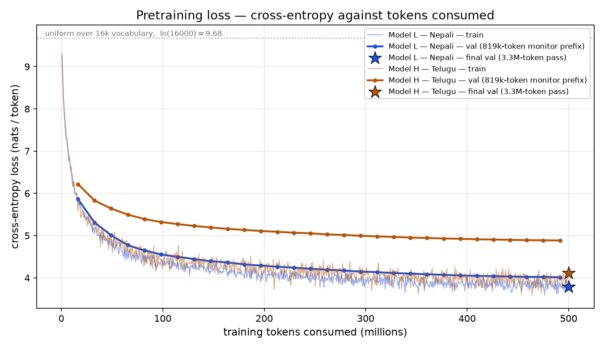

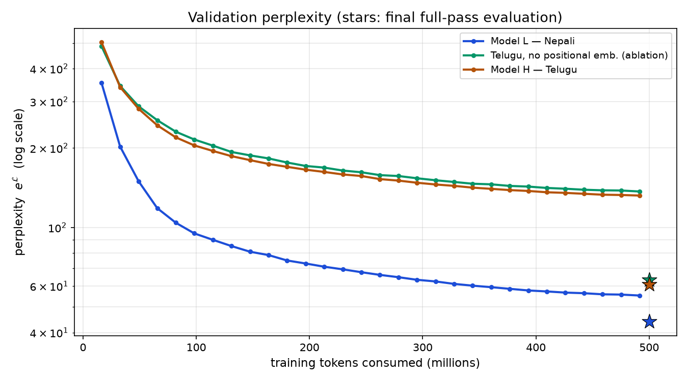

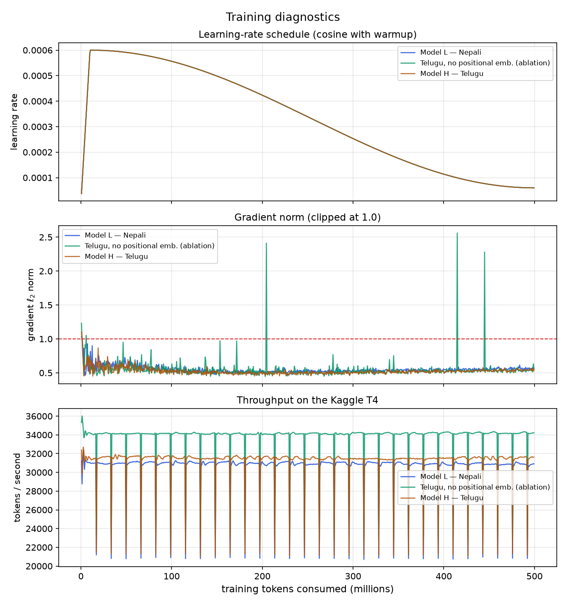

| run | steps | tokens | final train loss | final val loss | wall clock | mean tok/s |
|---|---:|---:|---:|---:|---:|---:|
| Model H — Telugu | 15,259 | 500,006,912 | 3.9916 | 4.10848 | 4.50 h | 31,130 |
| Model L — Nepali | 15,259 | 500,006,912 | 3.7804 | 3.78299 | 4.58 h | 30,558 |

Both runs completed the schedule exactly: $500{,}000{,}000 / 32{,}768 = 15{,}259$
steps, terminal learning rate landing on `min_learning_rate` = $6\times10^{-5}$,
gradient norms stable in the 0.5–0.6 range with no fp16 scaler divergence.
Initial loss 9.24 / 9.31 against the $\ln(16000) = 9.68$ uniform baseline.

**Two honest notes about the curves.**

*The in-training validation series is a fixed-prefix monitor, not the reported
number.* `common/train.py` evaluates on 50 batches during training (819,200
tokens, the head of the validation split) and on 200 at the end. Both are
truncated. The numbers in §3 come from `common/evaluate.py` over the **entire**
split. The figures label the two series distinctly and draw the final
evaluation as a separate marker rather than joining it to the monitor curve;
reporting them as one series would misrepresent them.

*Telugu's monitor sits ~0.9 nats above its own training loss for the whole
run, from the first evaluation onward.* This is **not** overfitting — an
overfitting gap opens over time, and this one is constant from step 500. It
means the head of the Telugu validation split is distributionally different
from its training set, a source-composition artifact of how Phase 1 wrote the
splits. The full-split figure (4.064) is much closer to the training loss
(3.992), confirming the diagnosis. Nepali's monitor tracks its training loss
closely and shows no such offset.

---

## 3. Intrinsic language-modelling evaluation

Computed by `common/evaluate.py` over the entire split using non-overlapping
sequential windows, so the number is a property of the data rather than of a
random draw. Full tables: `report/phase2/stats/comparison.md`.

### 3.1 Results

**Validation split**

| metric | Model H — Telugu | Model L — Nepali |
|---|---:|---:|
| tokens scored | 3,751,936 | 4,964,352 |
| bytes per token | 10.3222 | 11.5191 |
| cross-entropy (nats/token) | 4.06372 | 3.72264 |
| **perplexity** | **58.19** | **41.37** |
| **bits per byte** | **0.5680** | **0.4662** |

**Test split**

| metric | Model H — Telugu | Model L — Nepali |
|---|---:|---:|
| tokens scored | 3,899,392 | 4,997,120 |
| bytes per token | 10.2489 | 11.5122 |
| cross-entropy (nats/token) | 4.09868 | 3.73057 |
| **perplexity** | **60.26** | **41.70** |
| **bits per byte** | **0.5770** | **0.4675** |

Validation and test agree to within 0.035 nats for both models, so neither
number is a fluke of one split.

### 3.2 Why bits-per-byte, and why it is the number to compare

Perplexity is **per token**, and the two models have different tokenizers.
Telugu encodes at 10.25 UTF-8 bytes per token, Nepali at 11.51 — a Nepali token
carries 12% more text. A lower Nepali perplexity could therefore partly mean
"Nepali tokens are bigger targets" rather than "the model is better."

Bits-per-byte removes the tokenizer from the comparison by dividing the model's
total information content by the size of the underlying *text*:

$$\text{BPB} = \frac{\mathcal{L}_{\text{nats}} \times n_{\text{tokens}}}{\ln 2 \times n_{\text{bytes}}} = \frac{\mathcal{L}_{\text{nats}}}{\ln 2 \times \text{bytes per token}}$$

Worked, for Telugu on test:

$$\text{BPB} = \frac{4.09868}{0.693147 \times 10.2489} = \frac{4.09868}{7.10403} = 0.5770$$

`bytes_per_token` is taken from Phase 1's `token_counts.json`, measured by
counting the UTF-8 length of exactly the documents that were encoded.
Recomputing it here by decoding would risk measuring something subtly
different — a detokenization artifact — and the two quantities must describe
the same text for the ratio to mean anything.

**Interpretation.** 0.5770 bits per byte means Model H compresses its own
language to $8 / 0.577 = 13.9\times$ below raw UTF-8; Model L reaches
$17.1\times$. The gap is 23.4% in Telugu's disfavour, and it survives the
tokenizer normalization.

---

## 4. Generation quality, diversity, and attention

### 4.1 Setup

200 prompts of 64 tokens each drawn from the held-out **test** split, 64 tokens
generated per prompt, scored against the reference continuation that actually
followed in the corpus. Four decoding settings: greedy, and temperature 0.5,
1.0, 1.5. The sampling seed is fixed and identical across settings, so
differences come from the decoding rule rather than from luck.

### 4.2 Results

**Model H — Telugu**

| metric | greedy | t0.5 | t1.0 | t1.5 |
|---|---:|---:|---:|---:|
| BLEU-4 | 0.3355 | **0.4133** | 0.0870 | 0.0294 |
| chrF++ | 10.2037 | 14.3944 | **17.0290** | 16.2336 |
| ROUGE-L | 0.0250 | **0.0305** | 0.0213 | 0.0091 |
| repetition rate (4-gram) | 0.6542 | 0.1476 | 0.0003 | 0.0000 |
| Distinct-1 | 0.1330 | 0.3963 | 0.7511 | 0.8284 |
| Distinct-2 | 0.1854 | 0.6717 | 0.9890 | 0.9989 |

**Model L — Nepali**

| metric | greedy | t0.5 | t1.0 | t1.5 |
|---|---:|---:|---:|---:|
| BLEU-4 | 3.8346 | **4.1533** | 3.6104 | 0.8601 |
| chrF++ | 15.3287 | 17.6747 | **19.4145** | 15.9964 |
| ROUGE-L | 0.0868 | **0.0932** | 0.0871 | 0.0329 |
| repetition rate (4-gram) | 0.4995 | 0.1854 | 0.0035 | 0.0000 |
| Distinct-1 | 0.1609 | 0.3085 | 0.5622 | 0.7214 |
| Distinct-2 | 0.2551 | 0.6064 | 0.9321 | 0.9919 |

### 4.3 Why each metric is or is not informative here

The spec asks for this explicitly, and these runs happen to contain unusually
direct evidence for the answer.

**All three are overlap metrics designed for tasks with a *correct* output** —
translation, summarization. Free-form continuation has no such thing. A model
can produce fluent, entirely reasonable Telugu that shares almost no 4-grams
with the single continuation that happened to follow in the corpus and score
near zero. The numbers are reported because they are required and because they
are comparable *between* Model H and Model L under identical conditions; they
are not measurements of quality in absolute terms.

**But they are not equally bad, and the data shows exactly how they fail.**
Compare the two models at $t = 1.0$:

| metric | granularity | Telugu | Nepali | Nepali / Telugu |
|---|---|---:|---:|---:|
| BLEU-4 | word 4-grams | 0.087 | 3.610 | **41.5×** |
| ROUGE-L | word LCS | 0.0213 | 0.0871 | 4.1× |
| chrF++ | character n-grams | 17.03 | 19.41 | **1.14×** |

The measured gap between the same two models shrinks from **41.5× to 1.14×**
purely as a function of whether the metric counts words or characters.
Bits-per-byte, the tokenizer-neutral intrinsic measure, puts the true gap at
1.23×. chrF++ (1.14×) is close to that; BLEU (41.5×) is off by a factor of
thirty.

The mechanism is morphology. Telugu is more strongly agglutinative than Nepali:
case, number and postpositional relations are fused into a single orthographic
word, where Nepali writes many of them as separate particles. One morphological
difference therefore changes an entire whitespace token in Telugu and destroys a
word-level $n$-gram match, while barely moving character overlap. **BLEU-4 on
Telugu is measuring Telugu's morphology, not Model H's competence.**

**Conclusion: chrF++ is the only one of the three worth reading across
languages here**, and even it should be read alongside BPB rather than instead
of it.

**Two implementation decisions this forced:**

- **ROUGE-L is implemented directly** (`common/generate.py::rouge_l`) as an LCS
  F-measure over whitespace tokens, rather than via the standard `rouge_score`
  package, whose tokenizer strips non-ASCII alphanumerics — it would reduce
  Telugu and Devanagari text to empty strings and silently report 0.0.
- **sacreBLEU is called with `tokenize="none"`.** Its default `13a` tokenizer is
  built around English punctuation and treats a run of Telugu or Devanagari as a
  single token, which would make BLEU meaningless rather than merely weak.
  Whitespace tokenization is the honest minimum for both scripts and the choice
  is recorded in the output JSON.

### 4.4 Diversity, repetition, and the right decoding setting

The diversity diagnostics tell a cleaner story than the overlap metrics.

**Greedy decoding degenerates.** Repetition rate 0.654 (Telugu) and 0.499
(Nepali) means the majority of 4-grams in a greedy sample are repeats of an
earlier 4-gram — the classic loop. Distinct-2 of 0.185 confirms it: fewer than
one bigram in five is unique.

**t = 0.5 is the operating point.** Repetition falls to 0.148 / 0.185 while BLEU
and ROUGE-L *peak* for both models. It is the only setting where the overlap
metrics and the diversity metrics agree.

**t = 1.5 is incoherence, not diversity.** Distinct-2 reaches 0.9989 — virtually
every bigram unique — which at this model scale means the sampler is exploring
the tail rather than the model producing varied fluent text. ROUGE-L collapses
to 0.0091 / 0.0329 accordingly.

**chrF++ peaks at t = 1.0 while BLEU peaks at t = 0.5**, for both models. This
is consistent rather than contradictory: chrF++ rewards character coverage,
which higher-entropy sampling provides, whereas BLEU needs long exact matches,
which only low-temperature decoding produces.

### 4.5 Qualitative assessment

Reading the samples in `report/phase2/stats/{telugu,nepali}_generation.json`:

> The output consists of real words of the language. Grammar holds **within a
> clause**. Generation stays on topic and continues coherently from where the
> prompt left off for roughly **4–5 words**, after which clauses of unrelated
> content begin to appear, repeatedly.

This is precisely the behaviour a 25M-parameter model trained on 500M tokens
should exhibit, and it lines up exactly with the attention analysis below. The
model has learned **local** structure — morphology, agreement within a clause,
and short-range collocation — and has not learned **discourse**: nothing in it
tracks a topic across 64 tokens. The coherence horizon of roughly 4–5 words
corresponds closely to the ~6-token mean attention distance of the local heads
in layers 3–5 (§4.7), which is the deepest local structure the model actually
built.

### 4.6 Attention heatmaps

Computed by `common/attention.py` over 3 held-out passages of 96 positions, on
the test split. The example passages and their per-position token tables are in
`report/phase2/stats/{telugu,nepali}_attention_tokens.md` — figure axes carry
token *positions* rather than token strings, because Matplotlib ships no Telugu
or Devanagari glyphs and token labels would render as empty boxes.

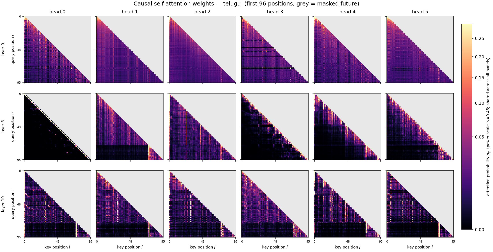

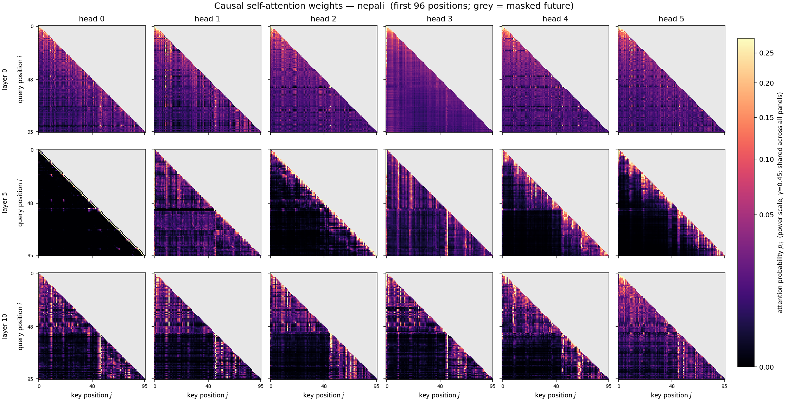

Each figure shows an early layer (0), a middle layer (5) and the final layer
(10), six heads each, with query position on the vertical axis and key position
on the horizontal. The grey upper triangle is the masked future — rendered as a
distinct colour rather than as dark, because "could not be attended to" and
"attended to with probability ≈ 0" are different statements. Every map is
strictly lower-triangular: visual confirmation of the causal mask.

All panels share one power-law colour scale ($\\gamma = 0.45$), so the colour
bar is true for every panel. Per-panel autoscaling with a shared bar would make
the bar meaningless for all but one. The power scale rather than a linear one is
what makes the faint vertical stripes visible at all: attention mass concentrates
heavily, so on a linear scale everything except the sink column washes out.

Three structures are worth looking for, and all three appear in both languages:
the **sink column** at $j = 0$; the **bright sub-diagonal** of the previous-token
head at layer 5, head 0; and the **L-shaped dark region** at the document
boundary, discussed in §4.8.

### 4.7 Attention entropy and distance

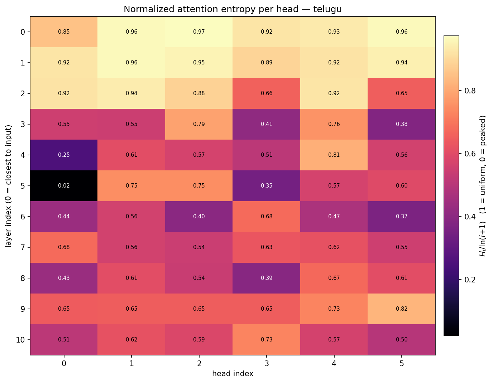
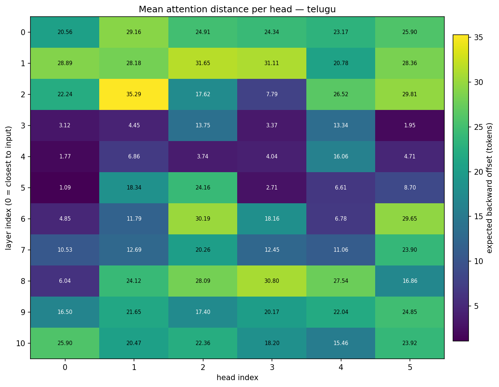
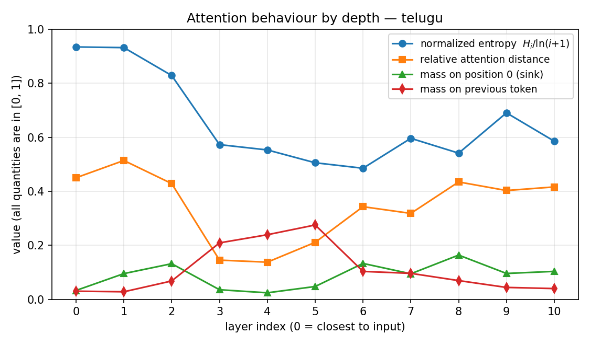

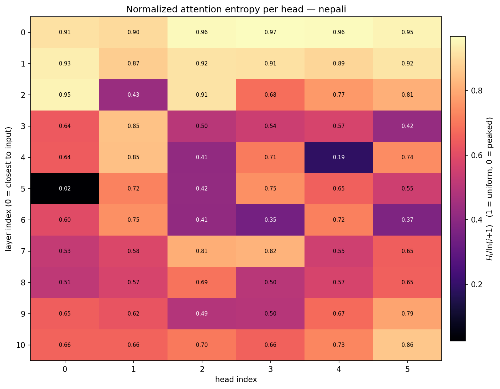
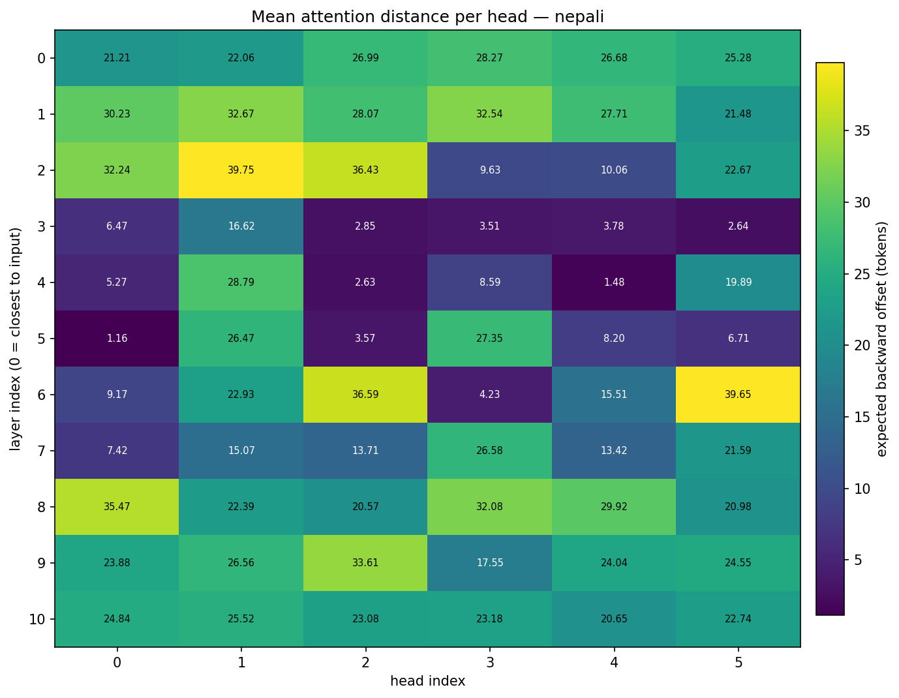
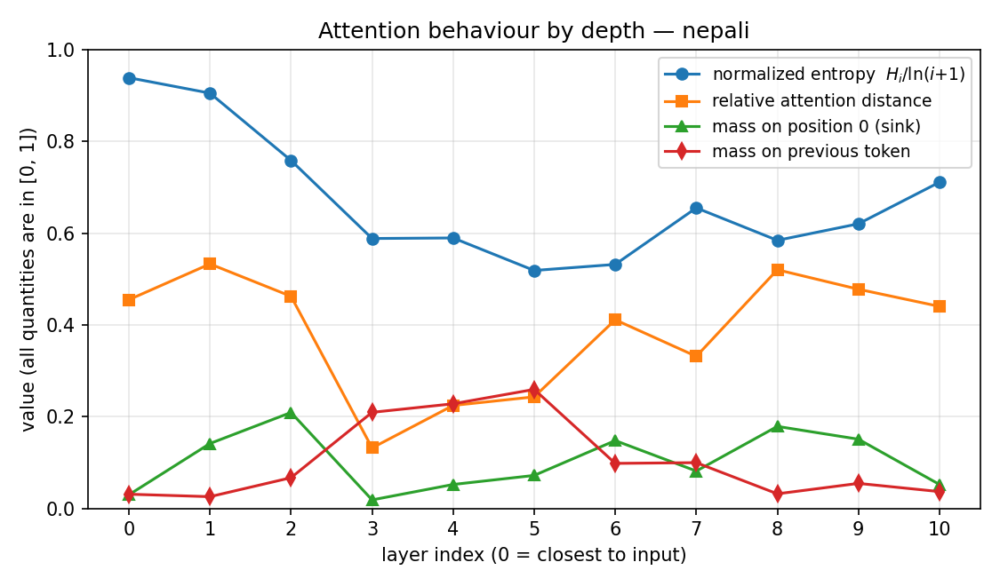

**A methodological point that changes the numbers.** Causal masking makes every
per-head statistic a function of position. At query position $i$ a head may
only distribute mass over $i+1$ keys, so its entropy is bounded above by
$\ln(i+1)$: position 0 has entropy exactly 0 no matter what it learned, and
position 5 cannot exceed $\ln 6 = 1.79$ even if perfectly uniform. Averaging
raw entropy over a sequence largely measures how long the sequence is.

Two corrections are therefore applied:

1. The first 16 query positions are excluded from every average — they are
   degenerate by construction.
2. Entropy is reported **normalized** as $H_i / \ln(i+1)$, the fraction of the
   maximum available at that position. A value near 1 means near-uniform over
   everything visible; near 0 means committed to a few keys. Distance is
   likewise reported both absolutely (tokens) and relatively (as a fraction of
   $i$).

**Model H — Telugu** · head types: 29 local, 20 diffuse, 17 content, 0 sink

| layer | norm. entropy | distance (tokens) | distance (rel.) | sink mass | prev-token mass |
|---:|---:|---:|---:|---:|---:|
| 0 | 0.935 | 24.67 | 0.450 | 0.033 | 0.030 |
| 1 | 0.932 | 28.16 | 0.514 | 0.095 | 0.028 |
| 2 | 0.829 | 23.22 | 0.429 | 0.132 | 0.068 |
| 3 | 0.573 | 6.66 | 0.145 | 0.035 | 0.209 |
| 4 | 0.553 | 6.20 | 0.138 | 0.024 | 0.239 |
| 5 | 0.506 | 10.27 | 0.211 | 0.047 | 0.275 |
| 6 | 0.485 | 16.90 | 0.343 | 0.133 | 0.103 |
| 7 | 0.596 | 15.15 | 0.318 | 0.095 | 0.096 |
| 8 | 0.541 | 22.24 | 0.435 | 0.164 | 0.069 |
| 9 | 0.691 | 20.44 | 0.403 | 0.096 | 0.044 |
| 10 | 0.585 | 21.05 | 0.416 | 0.103 | 0.040 |

**Model L — Nepali** · head types: 24 local, 25 diffuse, 16 content, 1 sink

| layer | norm. entropy | distance (tokens) | distance (rel.) | sink mass | prev-token mass |
|---:|---:|---:|---:|---:|---:|
| 0 | 0.939 | 25.08 | 0.455 | 0.030 | 0.031 |
| 1 | 0.905 | 28.78 | 0.533 | 0.141 | 0.026 |
| 2 | 0.759 | 25.13 | 0.462 | 0.209 | 0.067 |
| 3 | 0.588 | 5.98 | 0.132 | 0.018 | 0.209 |
| 4 | 0.590 | 11.11 | 0.224 | 0.052 | 0.228 |
| 5 | 0.519 | 12.24 | 0.243 | 0.072 | 0.259 |
| 6 | 0.532 | 21.35 | 0.411 | 0.148 | 0.098 |
| 7 | 0.655 | 16.30 | 0.331 | 0.081 | 0.100 |
| 8 | 0.584 | 26.90 | 0.520 | 0.179 | 0.032 |
| 9 | 0.620 | 25.03 | 0.478 | 0.151 | 0.054 |
| 10 | 0.711 | 23.33 | 0.440 | 0.052 | 0.037 |

### 4.8 Discussion: what the heads learned

**Both models independently converged on the same three-stage organization.**

```
                    entropy    distance      prev-token
layers 0-2   ┌──┐   0.93→0.83  ~25 tokens    0.03        diffuse global mixing
layers 3-5   ├──┤   0.57→0.51  ~6-12 tokens  0.21→0.28   LOCAL / positional
layers 6-10  └──┘   0.49→0.71  ~21 tokens    0.04        long-range content
```

- **Layers 0–2 are broad, near-uniform mixers.** Normalized entropy 0.93 means
  attention is close to uniform over everything visible. These layers are not
  selecting; they are averaging context into every position, building a local
  smoothed representation for later layers to sharpen.

- **Layers 3–5 are the local / positional heads.** Entropy drops by 40%,
  distance collapses to ~6 tokens (relative distance 0.13–0.14), and mass on the
  immediately preceding token *peaks* — 0.209 → 0.275 for Telugu, 0.209 → 0.259
  for Nepali. These are $n$-gram and morphology heads. Telugu layer 3 sits at
  6.66 tokens and Nepali layer 3 at 5.98: two separate corpora, separate
  vocabularies, separate seeds, and the same answer to within 11%.

- **Layers 6–10 are long-range content heads.** Distance climbs back to ~21–27
  tokens and previous-token mass falls to 0.03–0.05, so these heads are not
  reading position — they are selecting on content. Entropy rises again but
  stays well below the layer-0 level, meaning they are selective rather than
  diffuse.

**This directly explains the qualitative finding in §4.5.** The model's local
machinery is well developed — hence real words, correct within-clause grammar,
and 4–5 words of coherent continuation, which is roughly the span of the
layer-3–5 local heads. There is nothing above the ~25-token range doing topic
maintenance, so past that horizon the model drifts into unrelated clauses.

**Both models learned to reset context at document boundaries — the clearest
single result in this phase.** The training stream concatenates documents, and
both sampled passages happen to cross a boundary: Telugu at positions 74–75
(`</s>` then `<s>`), Nepali at 54–55, as the token tables in
`report/phase2/stats/*_attention_tokens.md` confirm.

In layers 5 and 10 of *both* models the heatmaps show a sharp L-shaped dark
region beginning exactly at that index: queries after the boundary place almost
no mass on keys before it, while attention within each document stays dense.
The boundary token itself becomes a bright vertical column — a local anchor
playing the same role for its document that position 0 plays for the sequence.

Nothing supervised this. The objective is next-token prediction and nothing in
it states that `</s>`/`<s>` separates unrelated text. The models discovered that
tokens before a boundary do not predict tokens after it and learned to gate them
out. This is content-conditional behaviour, not positional bookkeeping, and it
appeared independently in two models trained on separate corpora — which is
also why the layer-5 and layer-10 rows of the two heatmap figures look so alike
despite the languages sharing nothing.

**A pure previous-token head sits at layer 5, head 0 in both models.** It is
visible as a single bright sub-diagonal with everything else black, and it is
the 0.02 normalized-entropy cell in the Telugu table above — the most committed
head in either model. Two independent training runs put the same specialized
head in the same slot.

**Attention sinks are present but not dominant.** Sink mass (probability parked
on position 0, the standard no-op target when a head has nothing to contribute)
peaks at layer 2 for Nepali (0.209) and layer 8 for Telugu (0.164). Only one
head out of 132 across both models crosses the 0.60 threshold to be classed as
idle. The models are doing real work in nearly every head — worth stating,
because a stack full of sink heads would mean the capacity was wasted.

**Where the two models differ.** Nepali has slightly more diffuse heads (25 vs
20) and slightly fewer local ones (24 vs 29), and its long-range layers reach
further (26.9 tokens at layer 8 vs Telugu's 22.2). One reading is that Nepali's
lower-entropy corpus (§5) lets the model spend less capacity on local
disambiguation and more on longer-range structure. This is a hypothesis
consistent with the numbers, not something these two runs establish — a single
pair of models cannot separate a language effect from a corpus effect.

---

## 5. Resource-level comparison

### 5.1 The result

Model L — the *lower*-resource model — is better on every intrinsic measure:

| | Telugu (H) | Nepali (L) | gap |
|---|---:|---:|---:|
| Available training tokens | 666,507,564 | 501,331,128 | H has 33% more |
| Tokens consumed | 500,006,912 | 500,006,912 | equal |
| Fraction of corpus seen | 75.0% | 99.7% | |
| Test perplexity | 60.26 | 41.70 | L 31% lower |
| **Test BPB** | **0.5770** | **0.4675** | **L 19% lower** |

Because BPB divides out tokenizer fertility, this cannot be dismissed as a
tokenization artifact. And because both models are architecturally identical,
consumed identical token counts, saw no token twice, and used identical
hyperparameters, it cannot be a training-setup artifact either.

### 5.2 What it does *not* mean

It does not mean Nepali is an intrinsically easier language, and it does not
mean the lower-resource tier is advantaged. BPB measures **how compressible
this particular corpus is for a model of this size** — a joint property of the
language, the corpus, and the model. The corpus term dominates at 25M
parameters.

### 5.3 Hypotheses, and what the Phase 1 data does to them

**(a) Genre composition — the leading explanation.** The two manual collections
have opposite genre balances, recorded in the Phase 1 report:

| manual collection | news documents | book documents | dominant genre |
|---|---:|---:|---|
| Telugu | 167,000 | 39,000 | **news** (~81%) |
| Nepali | 26,600 | 37,733 | **books** (~59%) |

This is the most likely driver. Book prose is long-form, single-register and
internally coherent: one author, one topic, sustained syntax over thousands of
tokens. News is the opposite — dense in named entities, numerals, dates and
place names, with a hard topic reset at every article boundary. Named entities
and numerals are close to irreducible surprisal for a 25M-parameter model, since
there is nothing in the context that predicts *which* name or *which* number
comes next. A news-dominated corpus therefore has a higher entropy floor than a
book-dominated one, independently of how good the model is.

Telugu's corpus is news-dominated in its manual half and web-crawl in its
downloaded half; Nepali's manual half is book-dominated. That is exactly the
direction needed to explain a 19% BPB gap.

**(b) OCR noise — this hypothesis is ruled out by the data.** The natural first
guess is that OCR errors in scanned book text inflated Telugu's loss, since OCR
output is unpredictable by construction and every corrupted character
contributes near-maximal surprisal. The Phase 1 composition numbers eliminate
it: **Nepali's manual collection is proportionally about three times more
book-derived — and therefore more OCR-derived — than Telugu's**, and Nepali
still scores 19% better in bits per byte. If OCR noise were the dominant term,
the ranking would be reversed.

Worth stating explicitly in the report rather than quietly dropping, because it
is a hypothesis the corpus statistics actively refute rather than one that was
never considered.

**(c) Tokenizer fertility narrows the effective context.** Telugu encodes at
3.974 characters per token against Nepali's 4.343 (Phase 1 §4). Bits-per-byte
divides this out of the *loss*, but it does not divide it out of the *context
window*: at `block_size = 512`, Model H sees

$$512 \times 3.974 = 2{,}035 \text{ characters}$$

of context against Model L's $512 \times 4.343 = 2{,}224$ — about **9% less
text per window** for the same compute. A smaller effective context is a real
disadvantage, though 9% is unlikely to account for a 19% BPB gap on its own.

**(d) Script and orthographic inventory.** Telugu's writing system has a larger
inventory of distinct surface forms — complex conjuncts, a wide akshara space —
than Devanagari as used for Nepali. More distinct surface forms at the same
16,000-entry vocabulary means probability mass spread thinner. Plausible, but
partially entangled with (c), since fertility is itself a consequence of
orthography.

**(e) Corpus utilisation is *not* the explanation, despite appearances.** Telugu
saw only 75% of its available training data against Nepali's 99.7%. This looks
like it should favour Nepali — but both runs are strictly single-pass, so
neither model ever saw a token twice, and unused data cannot help a run that
never reaches it. Telugu's larger corpus is an advantage available to a *longer*
run, not to this one.

### 5.4 How to test this

The distinguishing experiment is cheap and requires training nothing: **score
each model separately on the news-derived and book-derived portions of its own
validation split.** Provenance tags are already recorded per document from
Phase 1, so the split costs only a filter.

Hypothesis (a) predicts a specific pattern: both models should show markedly
higher BPB on their news partition than on their books partition, and Telugu's
overall figure should sit closer to its news number because news dominates its
corpus. If instead the two partitions score similarly within each language, (a)
is wrong and (c)/(d) become the better explanations.

A second, independent check: compute the **unigram and bigram entropy of each
corpus** at the character level using `scripts/token_stats.py` from Phase 1. If
the Telugu corpus has measurably higher character-level entropy, the gap is
largely a data-floor property rather than a modelling failure — and 0.577 BPB
would then be close to the best any 25M-parameter model could do on that
corpus.

### 5.5 What both models share

Worth stating alongside the difference, because it is the more robust finding:

- Both reached the compute-optimal token budget for their size and show **no
  overfitting** — train and validation loss are within 0.12 nats (Telugu) and
  0.003 nats (Nepali). Both models are **data-limited, not capacity-limited**.
  The next lever is more tokens, not more parameters.
- Both learned the **same three-stage attention organization** (§4.8), with
  local heads at almost identical distances.
- Both show the same **decoding profile**: greedy loops, $t = 0.5$ optimal,
  $t = 1.5$ incoherent.

That two independently trained monolingual models on unrelated corpora converge
on this much shared structure is the strongest evidence in this phase that the
implementation is doing what a Transformer language model is supposed to do.

---

## 6. Bonus ablation — no positional embeddings

*(To be completed. Config: `telugu/configs/model_nopos.yaml`, identical to
Model H in every respect except `positional: none`, same seed, same data, same
schedule.)*

**Prediction, stated before the run.** Self-attention is permutation invariant,
so removing positional embeddings looks like it should destroy the model. It
should not, because **causal masking is itself a positional signal**: position
$t$ can attend to exactly $t+1$ keys, so the count of visible keys encodes
absolute position and a decoder-only Transformer can recover order from that
alone (Haviv et al., 2022). The expected outcome is a degradation on the order
of a few tenths of a nat — a result near $\ln(16000) = 9.68$ would indicate a
broken run, not a finding.

| | Model H (learned) | Ablation (none) | Δ |
|---|---:|---:|---:|
| Test cross-entropy | 4.09868 | *pending* | |
| Test perplexity | 60.26 | *pending* | |
| Test BPB | 0.5770 | *pending* | |

---

## 7. Reproduction

```bash
# tests (24 pass: 15 model, 9 training/checkpointing)
python -m pytest tests/ -q

# pretraining, one model
python -m common.train --config telugu/configs/model.yaml
python -m common.train --config telugu/configs/model.yaml --resume   # exact resume

# full evaluation: PPL/BPB, generation metrics, attention analysis
python scripts/run_eval.py --runs telugu nepali --n-prompts 200

# training curves from the JSONL logs (no GPU, no checkpoints needed)
python scripts/plot_training.py
```

Checkpoints are on Google Drive (links in the repository `README.md`); place
them at `checkpoints/<language>/best.pt` before running `run_eval.py`.

---

## 8. Deliverables

| # | Deliverable | Location |
|---|---|---|
| 1 | Transformer implementation (MHA, positional embeddings, causal mask) | `common/model.py`, `tests/test_model.py` |
| 2 | Model configuration files (H and L) | `telugu/configs/model.yaml`, `nepali/configs/model.yaml` |
| 3 | Parameter counts; training scripts; Drive links to checkpoints | §1.3; `common/train.py`; `README.md` |
| 4 | Training logs and loss curves | `report/phase2/logs/*.jsonl`, `report/phase2/figures/loss_curves.png` |
| 5 | PPL / BPB tables; BLEU, chrF, ROUGE-L results | §3, §4.2; `report/phase2/stats/comparison.md` |
| 6 | Generated samples and diversity / repetition stats | §4.2, §4.4; `report/phase2/stats/*_generation.json` |
| 7 | Attention heatmaps plus entropy / distance summaries | §4.6–4.8; `report/phase2/figures/*_attention_*.png` |
| 8 | Resource-level comparison write-up | §5 |

**Hard constraints observed.** No pretrained models. No pretrained tokenizers.
No HuggingFace Transformer classes. Two fully independent monolingual models —
separate data, separate tokenizer, separate vocabulary, separate weights,
neither initialized from the other. Positional embeddings, multi-head attention
and causal masking are all student-implemented. Every experiment is seeded and
reproducible from the configs and the commands in §7.

---

## References

- Vaswani et al. (2017), *Attention Is All You Need*
- Radford et al. (2019), *Language Models are Unsupervised Multitask Learners* (GPT-2)
- Hoffmann et al. (2022), *Training Compute-Optimal Large Language Models* (Chinchilla)
- Haviv et al. (2022), *Transformer Language Models without Positional Encodings Still Learn Positional Information*
- Xiao et al. (2023), *Efficient Streaming Language Models with Attention Sinks*
- Popović (2015), *chrF: character n-gram F-score for automatic MT evaluation*
- Post (2018), *A Call for Clarity in Reporting BLEU Scores* (sacreBLEU)
