# Phase 3 — Reasoning Finetuning, Attention Analysis, and Final Report

**Language Models and Agents, Monsoon 2026 — Individual Project**
Model H = Telugu (higher-resource) · Model L = Nepali (lower-resource, from the allowed list)
Branch `phase-3` · every figure and table referenced here is in `report/phase3/`;
Phase 1 and Phase 2 material is in `report/phase1/` and `report/phase2/`.

This document is the **final consolidated report**. Sections 1–4 cover Phase 3
(reasoning data, finetuning, reasoning evaluation, post-finetune attention);
Section 5 consolidates the whole project and answers the four questions the
specification asks; Section 6 is the reproduction and deliverables index.

---

## 0. Summary of results

| | **Model H — Telugu** | **Model L — Nepali** |
|---|---:|---:|
| Pretraining tokens (Phase 2) | 500,006,912 | 500,006,912 |
| Pretrained test bits-per-byte (Phase 2) | 0.5770 | 0.4675 |
| Synthetic reasoning set (train / val / test) | 6,000 / 500 / 1,000 | 6,000 / 500 / 1,000 |
| Reasoning exact match — **pretrained** | 0.005 | 0.000 |
| Reasoning exact match — **finetuned** | **0.269** | **0.250** |
| Scored-choice accuracy (chance 0.32) — pretrained → finetuned | 0.288 → 0.361 | 0.283 → 0.364 |
| Finetuned exact match, held-out phrasing | 0.252 | 0.227 |
| Finetuned exact match, 1 hop → 3 hops | 0.396 → 0.193 | 0.357 → 0.149 |
| LM bits-per-byte after finetuning (forgetting) | 0.5770 → 0.9587 | 0.4675 → 0.9256 |
| Finetune wall clock (one Kaggle T4) | 341 s | 362 s |

**In one paragraph.** Each model was finetuned on its own synthetic
comparative-reasoning set — held-out entity names and, for half the test set,
held-out phrasings — starting from its own pretrained checkpoint with its
tokenizer fixed. Finetuning took both models from essentially zero to ~26%
exact match, and the two models track each other closely on every slice: the
resource-tier gap that dominated Phase 2 (Nepali 19% better in bits-per-byte)
does not reappear on reasoning. But the gain is mostly **format**, not
**inference**: the finetuned models emit a well-formed answer 60% of the time,
yet on the tasks where the answer must be *derived* — yes/no over a chain,
"who is largest" — they sit at or near chance, accuracy falls with the number of
relations to chain, and diagnostics show positional and default-answer
heuristics rather than a comparison circuit. A first run with a 76-name pool
and full-sequence loss did worse (15%) for a diagnosable reason — it memorised
the answer distribution — and the second run's design choices follow directly
from that diagnosis (§2.3). The attention analysis (§4) shows what finetuning
did change: from the answer position, late-layer heads redirected 35–50% of
their mass onto the entity mentions in the premises (up from 18–37%), but not
selectively onto the *correct* entity, which is precisely the gap between
"learned to look at the names" and "learned to compare them."

---

## 1. Synthetic reasoning datasets (spec §3.1)

### 1.1 Construction

Both datasets are produced by one language-agnostic engine,
`common/reasoning_gen.py`, driven by a per-language lexicon
(`telugu/reasoning/lexicon.py`, `nepali/reasoning/lexicon.py`). The engine
never contains a Telugu or Nepali string; the lexicons never contain logic.
Nothing — no name, template, or example — is shared between the two datasets,
mirroring how the two models share `common/model.py` but no artifact.

Every example starts from a **hidden ground truth** — a random total order over
3–4 entities, or random numeric values — and the gold answer is computed from
it. The premises are then *rendered* through templates: each adjacent relation
is emitted at random as either "A is taller than B" or "B is shorter than A",
and the premises are shuffled, so the answer cannot be read off surface order.
Labels are therefore correct by construction, and
`tests/test_reasoning.py::test_labels_are_correct_by_independent_derivation`
re-derives every label from the hidden order without using the generator's
answer code.

**Five task families**, balanced 1,200 each in train and 200 each in test:

| task | premises | question | answer | chance |
|---|---|---|---|---|
| `superlative_chain` | chain over 3–4 entities | who is largest / smallest? | entity name | 1/n |
| `numeric_compare` | explicit values for 2–3 entities (15% ties) | who is larger / smaller? | name, or *equal* | 1/3 |
| `chain_relation` | A>B, B>C · or A>B, A>C (branching) | relation between the endpoints? | "X is more/less than Y", or *cannot be determined* | 1/3 |
| `yes_no` | chain over 3–4 entities | is X larger than Y? | yes / no | 1/2 |
| `ordering` | chain over 3–4 entities | list from largest to smallest (or reverse) | comma-separated names | 1/n! |

**Seven attributes** with their own vocabulary: for people — height, age,
weight, running speed, exam marks; for objects — price, weight. Each attribute
has separate templates for the "more" relation, the "less" relation, the
superlative question, the pairwise question, the yes/no question, the
relation-answer statement, and the ordering instruction: **199 templates per
language**, plus optional framing sentences.

Examples of what the models see (test split, held-out names):

> **Telugu, `superlative_chain`, price, 4 entities** — *ఈ సమాచారం ఆధారంగా ప్రశ్నకు జవాబు చెప్పండి. కంప్యూటర్ గొడుగు కంటే ఖరీదైనది. కంప్యూటర్ ధర గడియారం ధర కంటే తక్కువ. రేడియో కంటే గడియారం ఖరీదు తక్కువ. వీటిలో తక్కువ ధర ఉన్నది ఏది? జవాబు:* → **గొడుగు**
>
> **Nepali, `chain_relation`, price** — *तलका वाक्यहरू पढेर उत्तर दिनुहोस्। टिभीभन्दा झोला महँगो छ। कम्प्युटर टिभीभन्दा सस्तो छ। कम्प्युटर र झोलाको मूल्यबीच के सम्बन्ध छ? उत्तर:* → **कम्प्युटर झोलाभन्दा सस्तो छ**

More in `report/phase3/stats/{telugu,nepali}_reasoning_samples.md`.

**Phrasing.** Telugu uses the honorific plural for people (ఉన్నారు, పెద్దవారు),
which is ordinary respectful usage and avoids tracking grammatical gender per
name; objects take the neuter. Nepali attaches the comparative postposition
भन्दा, the genitive को and the ergative ले directly to the noun (हरिभन्दा,
रामको, रामले), as standard orthography does. Numbers are ASCII digits in Telugu
and Devanagari digits (१७२) in Nepali — in each case the form the Phase 1
tokenizer handles best (it has dedicated pieces for two-digit Devanagari
groups). A test asserts that >95% of the letters in every prompt and answer are
in the target script.

**Entity names.** Run 1 used 76 simple given names per language. Run 2 adds
compound given names, which are the norm in both cultures — Telugu joined
(వెంకటరావు, శివప్రసాద్, నాగలక్ష్మి), Nepali spaced (राम प्रसाद, हरि बहादुर, सीता
देवी) — built from culturally standard first and second elements: **540 names
for Telugu, 436 for Nepali**, plus 30 object nouns each. Why this matters is in
§2.3.

### 1.2 Sizes and statistics

| | Telugu | Nepali |
|---|---:|---:|
| train / validation / test | 6,000 / 500 / 1,000 | 6,000 / 500 / 1,000 |
| name pool: train / val / test (disjoint) | 350 / 81 / 108 | 284 / 65 / 87 |
| object pool: train / val / test (disjoint) | 20 / 4 / 6 | 20 / 4 / 6 |
| templates (families with a reserved test-only phrasing) | 199 (85) | 199 (85) |
| test examples using a held-out phrasing | 513 | 506 |
| prompt tokens (train), mean / max | 36.7 / 61 | 39.2 / 64 |
| answer tokens (test), mean / max | 3.7 / 13 | 3.9 / 13 |
| training tokens per epoch (with `<s>`/`</s>`) | 255,200 | 270,204 |
| hops in test: 1 / 2 / 3 | 326 / 529 / 145 | 339 / 513 / 148 |

Full breakdowns (by task, attribute, entity count, answer kind) are in
`report/phase3/stats/{telugu,nepali}_reasoning_data.json`.

### 1.3 How train–test leakage is prevented

1. **Held-out entity names.** Names and objects are partitioned into three
   disjoint pools (65 / 15 / 20%), a deterministic function of the seed. A
   test example never mentions an entity that occurs in training.
   `test_no_entity_leakage_between_splits` checks the pools *and* the emitted
   examples.
2. **Held-out templates.** In every template family with two or more
   phrasings, the last phrasing is reserved for the test split. Half of the
   test examples are built from the reserved phrasings throughout, and are
   flagged `template_held_out`, so accuracy on seen and unseen wording is
   reported separately (§3.3). `test_held_out_templates_never_appear_in_train`
   scans every training and validation prompt for every reserved phrasing.
3. **Exact deduplication** of normalised prompts across all three splits.
4. **Determinism.** Seed 1337 (Telugu) and 2718 (Nepali) — the same seeds as
   the pretraining runs — regenerate byte-identical files;
   `test_committed_dataset_matches_generator` proves the committed test split
   equals what the script emits.

Validation and test splits are committed under `<lang>/reasoning/dataset/`;
the train split is regenerated in two seconds by
`python -m <lang>.reasoning.generate`.

---

## 2. Finetuning (spec §3.1 protocol)

### 2.1 Setup

`common/finetune.py`, configured by `telugu/configs/finetune.yaml` and
`nepali/configs/finetune.yaml`. Each run:

- starts from **that language's own** pretrained `best.pt` (Phase 2, step
  15,259, 500M tokens) — the architecture is read from the checkpoint rather
  than repeated in the finetune config, so the two can never disagree, and it
  is copied into every finetune checkpoint;
- keeps the **tokenizer and vocabulary fixed** — the Phase 1 SentencePiece
  model; no token is added, the answer prefix (జవాబు: / उत्तर:) is ordinary text;
- uses a **fresh AdamW** (the pretraining moments describe a different objective
  at a different learning rate);
- writes checkpoints in **exactly the pretraining format** — weights, both
  AdamW moments, GradScaler, step, tokens, full config, NumPy / CPU / CUDA RNG
  state, atomic write — plus the epoch and batch index, so a resume continues
  at the right example. `test_finetune_resume_is_bit_exact` asserts that a
  run stopped with `--session-steps` and resumed yields weights identical to
  an uninterrupted run.

**Batching.** Examples are ~40 tokens; padding each to the 512-token context
would waste >90% of every batch. Instead each epoch shuffles the examples
(seeded by epoch number) and packs whole examples `<s> prompt answer </s>`
back to back into 512-token rows — ~13 per row — which is the same shape the
model saw in pretraining, where documents were concatenated with the same
markers and the Phase 2 attention analysis showed both models gate attention
at those boundaries.

**Hyperparameters** (identical for both languages; all recorded in the YAML and
inside every checkpoint):

| | run 1 | **run 2 (reported)** |
|---|---|---|
| train examples · name pool | 30,000 · 76 | 6,000 · 540 / 436 |
| epochs · optimizer steps | 8 · 1,176 / 1,288 | 30 · 990 / 1,050 |
| batch (rows × tokens) | 16 × 512 | 16 × 512 |
| learning rate, schedule | 1e-4 → 1e-5, 50-step warmup, cosine | 3e-4 → 3e-5, 50-step warmup, cosine |
| loss | full sequence (`prompt_loss_weight` 1.0) | **answer tokens only** (0.0) |
| weight decay · β₁, β₂ · clip · dropout | 0.1 · 0.9, 0.95 · 1.0 · 0.1 | same |
| precision | fp16 + GradScaler (T4) | same |
| seed | 1337 / 2718 | same |
| checkpoint selection | best validation exact match (evaluated every 50 steps on the whole validation split) | same |

The learning rate is a pure function of the step, as in pretraining, so
resume never has to trust a serialised scheduler.

### 2.2 Training outcome

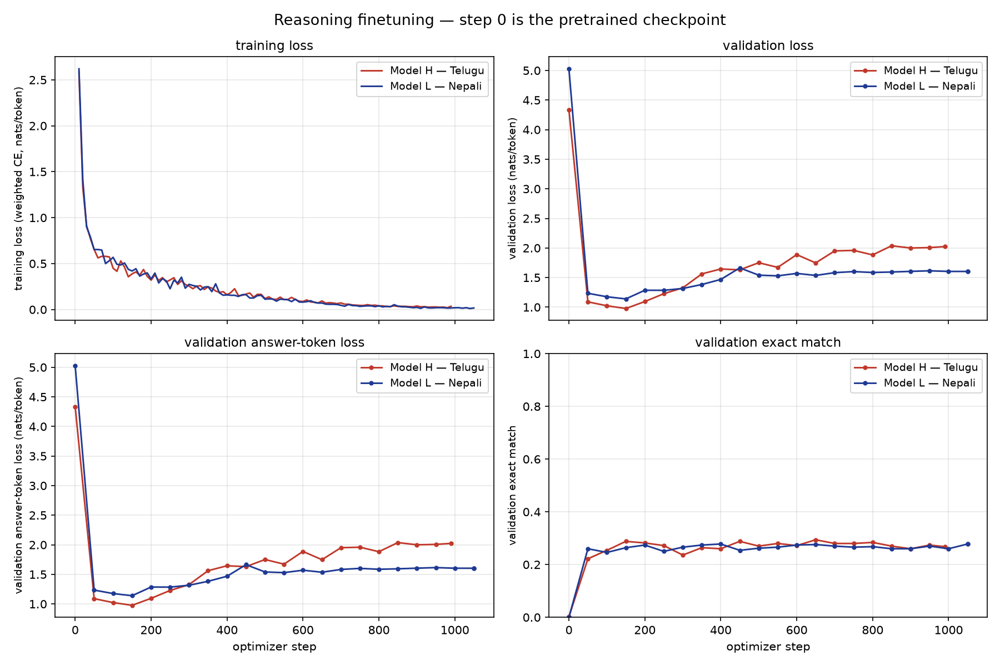

| | Telugu | Nepali |
|---|---:|---:|
| steps · tokens · wall clock | 990 · 7.64M · 341 s | 1,050 · 8.09M · 362 s |
| throughput | 30,525 tok/s | 30,316 tok/s |
| validation answer loss: step 0 → minimum → final | 4.34 → **0.98** (step 150) → 2.02 | 5.03 → **1.14** (step 150) → 1.60 |
| training answer loss, final | 0.035 | 0.017 |
| validation exact match: step 0 → best → final | 0.002 → **0.294** (step 650) → 0.268 | 0.000 → **0.278** (step 400) → 0.278 |
| checkpoint reported (`best.pt`) | step 650 | step 1,050 |

Two things in the curves matter for everything that follows. The **validation
answer loss reaches its minimum after five epochs (step ~150) and then rises**
while training loss keeps falling toward zero: after epoch 5 the model is
memorising the 6,000 training examples, and by the end it reproduces its
training answers with near certainty (loss 0.02–0.04) while assigning the
held-out answers 1.6–2.0 nats. **Exact match, however, plateaus rather than
falls** — from step 50 onward both models sit in a 0.22–0.29 band. The two
facts together say that whatever the model learned that generalises, it
learned in the first ~100 steps; the remaining 900 steps sharpened it on
training names without changing what it does on new ones.

### 2.3 Run 1, and why run 2 looks the way it does

Run 1 (30,000 examples, 76 names, full-sequence loss, LR 1e-4) finished with
validation exact match 0.15 (Telugu) and 0.17 (Nepali), flat from step 50, and
on the test split scored **0.5% on `superlative_chain`** — far below the ~33%
of guessing any name in the prompt. Inspection showed the model answering
name questions with *training* names that did not appear in the prompt at
all. That is the signature of a model that learned the **distribution of
answers** rather than to **copy the right entity from the premises**: with 50
training names each was the gold answer ~200 times, so "emit a frequent name"
was a cheaper solution than reading the relations.

Full-sequence loss makes this worse in a specific way: it asks the model to
predict the *first mention* of every random name inside the premises, which
is impossible except through a prior over names — so it trains precisely the
reflex that is wrong at the answer position. Run 2 therefore (i) enlarges the
name pool ~6× with compound names, so no name is a frequent answer, and (ii)
supervises the answer tokens only. It was also sized at 6,000 / 500 / 1,000 to
stay within the course guidance of 4,000–8,000 examples, with the epoch count
raised so the optimiser-step budget stayed comparable. The LR was raised to
3e-4 because 1e-4 is the pretraining *terminal* rate and run 1 never moved out
of its initial basin.

Run 2 improved exact match by 10–12 points and fixed the specific symptom
(superlative went from 0.5% to 31.5% in Telugu, i.e. from "not a name in the
prompt" to "a name in the prompt"). Its cost is in §3.4.

---

## 3. Reasoning evaluation (spec §3.1 report)

`scripts/run_phase3.py` → `report/phase3/stats/comparison.md`. Two accuracies
are reported for every checkpoint, on the full 1,000-example test split:

- **Exact match (generative).** Greedy decoding after the answer prefix until
  `</s>`; the decoded string, NFC-normalised, whitespace-collapsed and stripped
  of a trailing `.`/`।`, must equal the gold answer. Prompts are batched in
  buckets of identical token length so no padding is ever fed to the model.
- **Scored choice.** Every example carries a candidate set (the entity names;
  yes/no; the three possible relation statements; the permutations of an
  ordering). Each candidate is appended to the prompt and scored by total
  log-likelihood; the argmax is the prediction. This isolates *preferring the
  right answer* from *producing it in the right format*, and is the only way
  to say anything about the pretrained model beyond "it does not know the
  format". Candidates are right-padded, which is exact under a causal mask.

### 3.1 Pretrained vs finetuned

| | Telugu pretrained | Telugu finetuned | Nepali pretrained | Nepali finetuned |
|---|---:|---:|---:|---:|
| **exact match** | 0.0050 | **0.2690** | 0.0000 | **0.2500** |
| prediction is a valid option | 0.032 | 0.607 | 0.000 | 0.594 |
| scored-choice accuracy | 0.288 | 0.361 | 0.283 | 0.364 |
| scored-choice chance | 0.319 | 0.319 | 0.319 | 0.319 |

The pretrained models continue the prompt as prose — the Telugu model
typically repeats a premise (*బాటిల్ ధర బకెట్ ధర కంటే తక్కువ. బాటిల్ ధర...*); the
Nepali model, whose corpus is 59% books, drifts into Wikipedia-style section
headers (*सन्दर्भ सामग्रीहरू / बाह्य कडीहरू*). Their scored-choice accuracy is
*below* chance (0.288 / 0.283 vs 0.319): the pretrained likelihood prefers
whichever candidate is a more plausible continuation, which is systematically
not the correct one.

### 3.2 By task

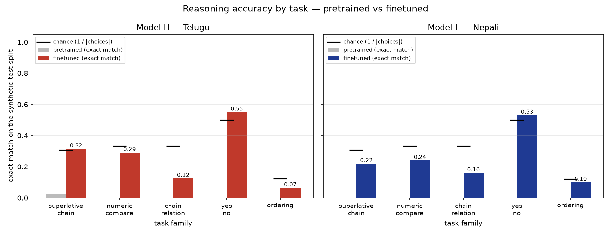

| task (chance) | Telugu pre | Telugu ft | Nepali pre | Nepali ft |
|---|---:|---:|---:|---:|
| superlative_chain (≈0.31) | 0.025 | 0.315 | 0.000 | 0.220 |
| numeric_compare (0.33) | 0.000 | 0.290 | 0.000 | 0.240 |
| chain_relation (0.33) | 0.000 | 0.125 | 0.000 | 0.160 |
| yes_no (0.50) | 0.000 | 0.550 | 0.000 | 0.530 |
| ordering (≈0.12) | 0.000 | 0.065 | 0.000 | 0.100 |

Read against chance, this is a model that has learned **what kind of thing
to say** but not **which one**: superlative and numeric comparison are at the
level of choosing a name from the prompt at random; yes/no is at coin-flip;
`chain_relation`, whose answers are full sentences, is below chance because a
sentence must be reproduced exactly; ordering is barely above its (small)
chance because a 3-name list has to be entirely right.

### 3.3 Generalisation slices (finetuned)

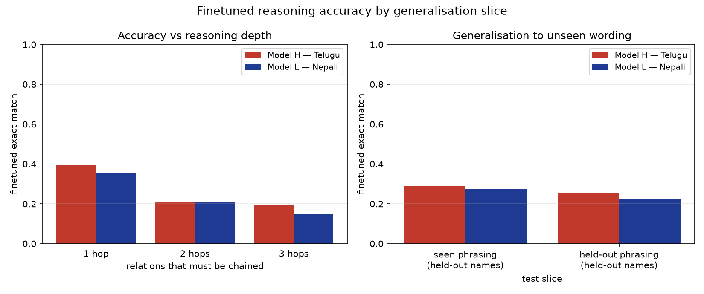

| slice | Telugu | Nepali |
|---|---:|---:|
| seen phrasing, held-out names | 0.288 (n=487) | 0.273 (n=494) |
| held-out phrasing, held-out names | 0.252 (n=513) | 0.227 (n=506) |
| 1 hop | 0.396 (n=326) | 0.357 (n=339) |
| 2 hops | 0.212 (n=529) | 0.209 (n=513) |
| 3 hops | 0.193 (n=145) | 0.149 (n=148) |
| person attributes (age / height / marks / speed / weight) | 0.34 / 0.34 / 0.35 / 0.31 / 0.26 | 0.33 / 0.24 / 0.31 / 0.28 / 0.39 |
| object attributes (price / weight) | 0.13 / 0.17 | 0.07 / 0.13 |

Three observations. **Unseen wording costs only 3.6–4.6 points**, so the
templates were varied enough that the model is not matching surface strings.
**Accuracy halves from one hop to three**, the clearest sign that the chain is
not being followed — a genuine transitive-reasoning circuit would not care
much how long the chain is at these lengths. **Object questions are far worse
than person questions**: the object pool is small (6 held-out nouns) and the
object relations use a different construction (X ధర Y ధర కంటే ఎక్కువ — "X's
price is more than Y's price" — where the entity is not sentence-initial),
which the model handles less well.

### 3.4 Error analysis and qualitative examples

Classifying every finetuned test prediction
(`report/phase3/stats/<lang>_finetuned_reasoning_test.json`):

| prediction is … | Telugu | Nepali |
|---|---:|---:|
| the gold answer | 269 | 250 |
| a *valid* option, but the wrong one | 338 | 344 |
| an entity from the prompt that is not an option (wrong kind of answer) | 59 | 37 |
| a malformed string (wrong relation sentence, repeated name, …) | 333 | 367 |
| empty | 1 | 2 |

Two heuristics account for most of the "valid but wrong" mass:

- **Yes/no is a default, not a judgement.** Telugu answers కాదు ("no") 167
  times out of 200 and అవును 33; Nepali answers हो ("yes") 132 times and होइन
  68. Each model picked a majority answer during training and emits it
  regardless of the premises. The 55% / 53% accuracy is the base rate, not
  comprehension.
- **Superlative picks are positional.** On `superlative_chain`, Telugu chose
  the *last-mentioned* entity 75 times, the first-mentioned 27 and a middle
  one 35 (63 answers were not an entity at all). The model learned "the
  answer is a name near the end of the premises" — a recency heuristic that
  is right whenever the last premise happens to mention the extreme entity.

Successes and failures per task, with prompts, are in
`report/phase3/stats/{telugu,nepali}_finetuned_reasoning_examples.md`
(and `*_pretrained_reasoning_examples.md` for the baseline). Representative
failures:

> **Telugu `chain_relation`** — gold *బకెట్ కుర్చీ కంటే బరువు* ("bucket is heavier than chair"), predicted **బల్ల** — a name from the prompt, the wrong *kind* of answer.
> **Telugu `chain_relation`** — gold *బాటిల్ బకెట్ కంటే చౌక*, predicted **బల్ల బల్ల కంటే ఖరీదు** — the right *shape* of sentence, but the same entity on both sides and the wrong polarity.
> **Nepali `chain_relation`** — gold *महेश भीम प्रसादभन्दा जेठो छ*, predicted **भन्न सकिँदैन** ("cannot be determined") — the model over-uses the escape answer, which is 25% of that task's training labels.
> **Telugu `chain_relation`, branching premises** — gold *చెప్పలేము* ("cannot be determined"), predicted **అవును** ("yes") — the *opposite* failure: a yes/no answer to a relation question.

And representative successes (both models, held-out names *and* held-out phrasing):

> **Telugu `numeric_compare`** — *శ్రీరెడ్డికి 57 ఏళ్లు. శ్రీకాంత్కి 28 ఏళ్లు. శ్రీరెడ్డి మరియు శ్రీకాంత్ లలో ఎక్కువ వయసు ఎవరిది? జవాబు:* → **శ్రీరెడ్డి** ✓
> **Telugu `superlative_chain`, 2 hops** — *శ్రీరాణి కంటే శివరెడ్డికి ఎక్కువ మార్కులు. శ్రీరాణి కంటే భవకుమారికి తక్కువ మార్కులు. ఎవరి మార్కులు అందరికంటే ఎక్కువ? జవాబు:* → **శివరెడ్డి** ✓
> **Nepali `numeric_compare`** — *भीम नारायण ३६ वर्षको छ। बल दत्त १४ वर्षको छ। बल दत्त र भीम नारायण मध्ये कसको उमेर कम छ? उत्तर:* → **बल दत्त** ✓

### 3.5 What finetuning cost: language-modelling retention

The finetuned checkpoints were re-scored on the Phase 1 held-out corpus with
the Phase 2 evaluator (`common/evaluate.py`, whole split):

| | Telugu pre | Telugu ft | Nepali pre | Nepali ft |
|---|---:|---:|---:|---:|
| test cross-entropy (nats/token) | 4.099 | 6.811 | 3.731 | 7.386 |
| test perplexity | 60.3 | 907.6 | 41.7 | 1613.2 |
| **test bits per byte** | **0.577** | **0.959** | **0.468** | **0.926** |

Answer-only supervision for 30 epochs on 0.26M tokens of templated text
**cost the models most of their language modelling**: +2.7 / +3.7 nats, a
15×/39× rise in perplexity. Run 1, with full-sequence loss and a third of the
learning rate, retained far more (Telugu test BPB 0.665 rather than 0.959).
This is the trade the two runs bracket: run 1 keeps the language model and
learns the answer prior; run 2 learns the format and to look at the names, and
forgets the language. Neither, at 25M parameters and a few thousand examples,
learns to *compare*. A mixed objective — a small prompt-loss weight, or
interleaving pretraining text — is the obvious next experiment and was not run
for lack of time.

**H vs L on reasoning.** Across every table above the two models are within a
few points of each other, with Telugu slightly ahead on exact match (0.269 vs
0.250) and Nepali slightly ahead on scored choice (0.364 vs 0.361). The Phase 2
resource-tier gap does not carry over: reasoning accuracy here is bounded by
model size and the finetune set, not by the pretraining corpus.

---

## 4. Attention analysis after finetuning (spec §3.2)

The Phase 2 toolkit (`common/attention.py`: normalised entropy, mean attention
distance, sink mass, previous-token mass, head labels) is reused unchanged.
What changes is the input: `common/attention_compare.py` runs the pretrained
**and** the finetuned checkpoint on the **same 15 test prompts** (3 per task,
rendered exactly as in training, `<s> prompt answer </s>`), so any difference
in the maps is attributable to finetuning and to nothing else. Averages skip
the first 4 positions rather than 16, because these sequences are ~40 tokens.

A measurement specific to this phase: for the query positions that *produce
the answer*, the attention mass landing on (a) any entity mention in the
premises and (b) the gold entity's mentions, located via the tokenizer's piece
offsets. A head whose gold-entity mass rises after finetuning is a head that
learned to look at the right thing.

### 4.1 Heatmaps — early and late layer, pretrained vs finetuned

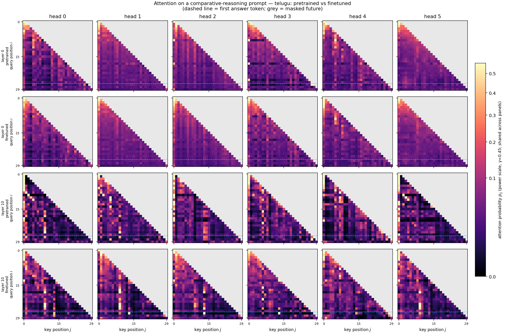

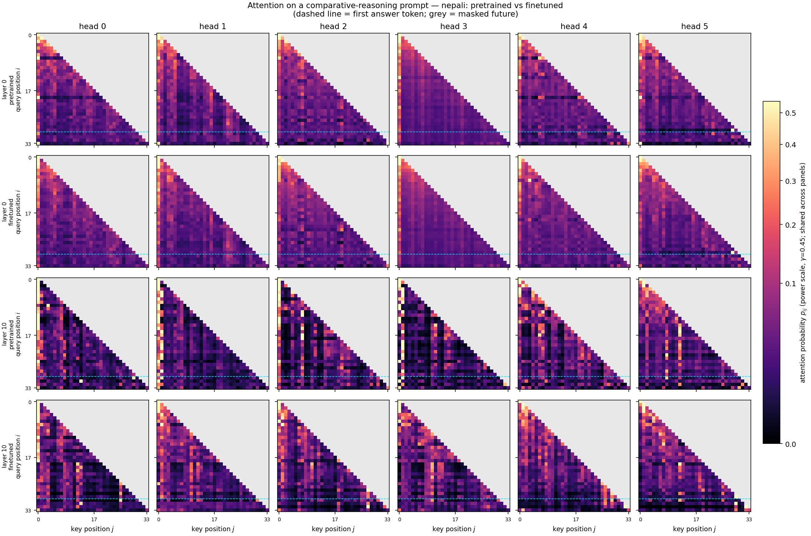

Rows alternate pretrained / finetuned for layer 0 and layer 10 on one
`superlative_chain` prompt (token table:
`report/phase3/stats/<lang>_finetuned_reasoning_attention_tokens.md`); the
dashed line marks the first answer position. **Layer 0 is unchanged** — the
same broad, near-uniform mixing in both checkpoints. **Layer 10 is where
finetuning shows**: the bright column at key position 0 — the attention sink —
that dominates several pretrained heads (0, 2, 3) is much fainter after
finetuning, the maps are lighter and broader, and the vertical stripes at the
entity-name positions (keys ~7–13 in this prompt) are stronger. The answer
positions read across the premises rather than parking mass on the sink.

### 4.2 Per-layer statistics on reasoning prompts

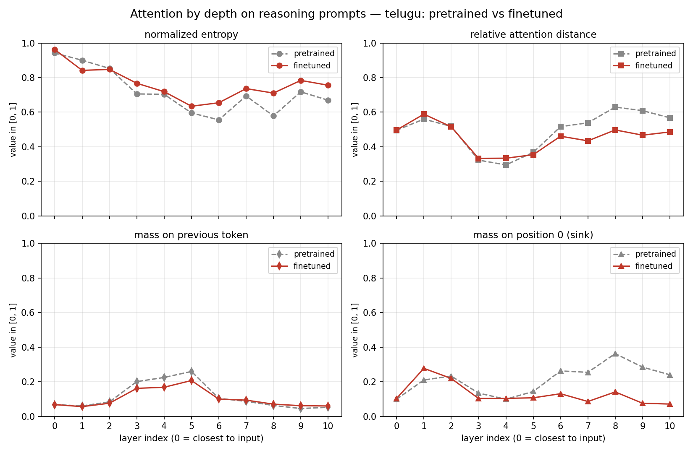
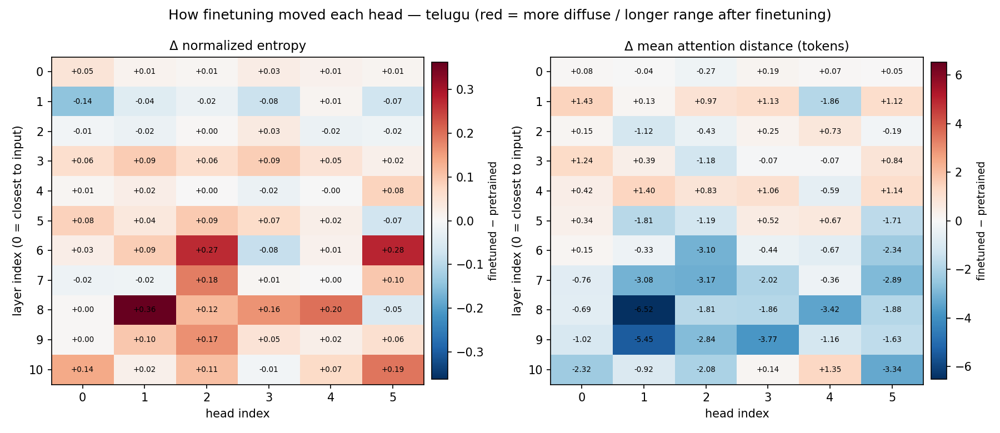
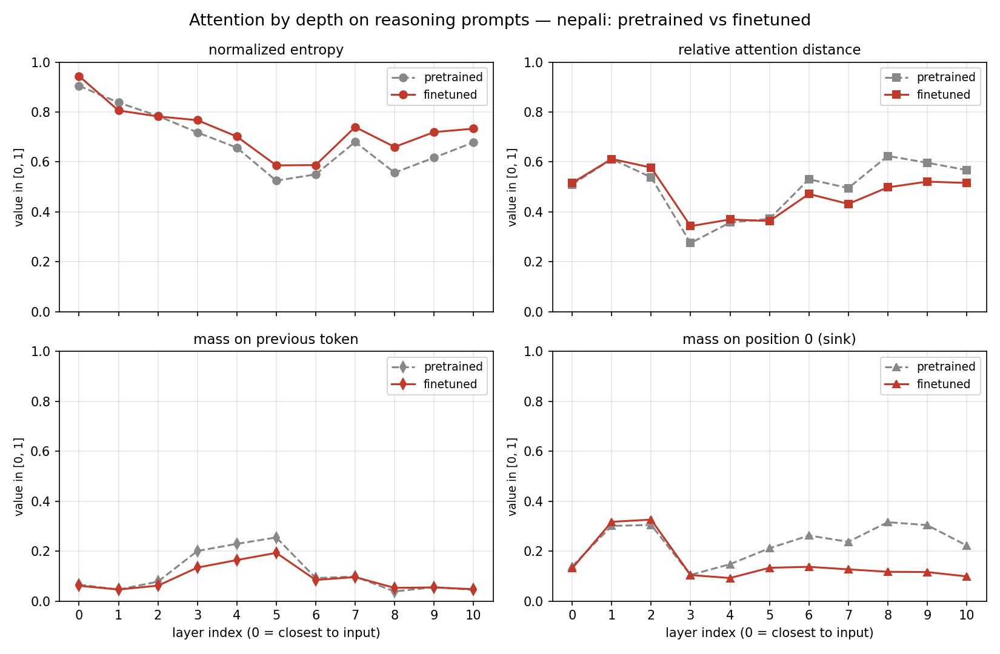
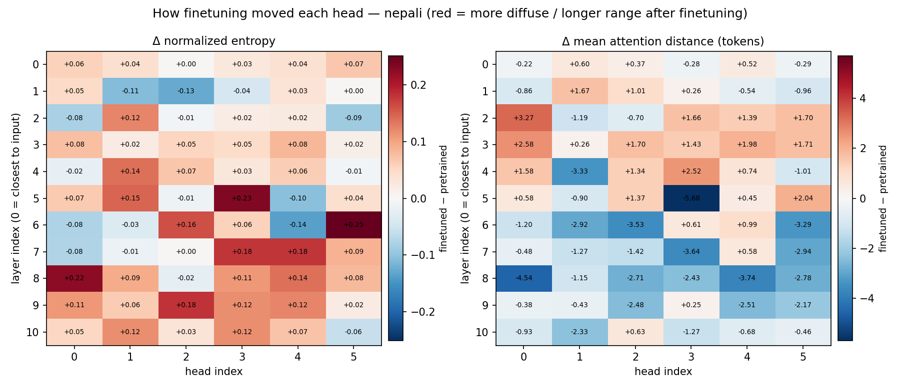

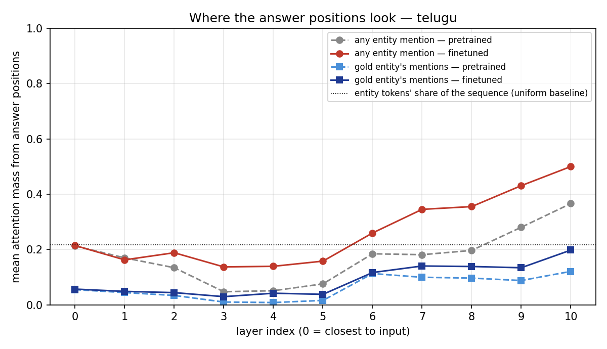
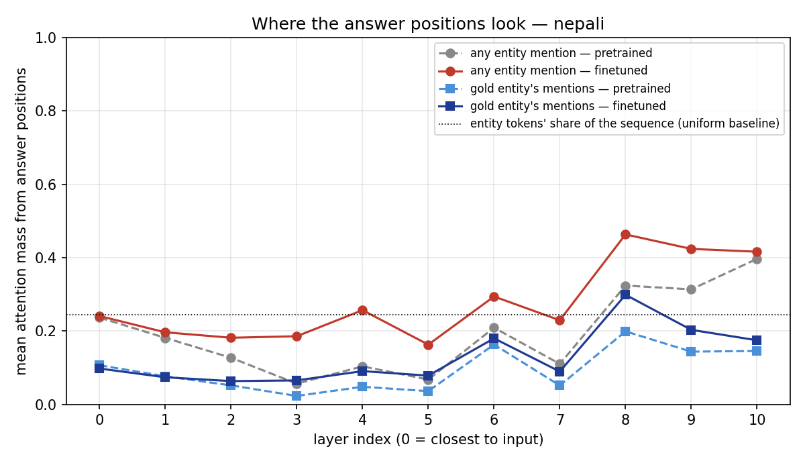

| | Telugu pre → ft | Nepali pre → ft |
|---|---|---|
| head types (diffuse / local / content / sink) | 34 / 15 / 16 / 1 → **46 / 14 / 6 / 0** | 27 / 15 / 22 / 2 → **40 / 12 / 13 / 1** |
| normalised entropy, layers 6–10 (mean) | 0.643 → **0.728** | 0.616 → **0.688** |
| mean distance, layers 8–10 (tokens) | 12.4 → **10.2** | 13.6 → **12.0** |
| previous-token mass, layers 3–5 (mean) | 0.229 → **0.179** | 0.228 → **0.164** |
| sink mass (position 0), layers 6–10 (mean) | 0.281 → **0.101** | 0.269 → **0.119** |
| entity mass from answer positions, layer 10 | 0.366 → **0.500** | 0.397 → 0.416 |
| entity mass from answer positions, layers 7–9 (mean) | 0.219 → **0.377** | 0.249 → **0.372** |
| gold-entity mass, layer 10 (best layer) | 0.121 → **0.198** | 0.199 → **0.299** (layer 8) |
| entity tokens' share of the sequence (uniform baseline) | 0.217 | 0.245 |

Full per-layer tables: `report/phase3/stats/comparison.md` §5;
per-head values: `report/phase3/stats/<lang>_attention_compare.json`.

### 4.3 What changed, and what did not

**Finetuning did not touch the early layers and did not create new local
heads.** Layers 0–2 are statistically identical before and after. The local /
positional stage (layers 3–5, the previous-token heads identified in Phase 2)
survives but *weakens*: previous-token mass falls by a fifth to a quarter in
both models. Nothing about comparative prompts rewards n-gram prediction, and
answer-only loss removes the objective that built those heads.

**The late layers became more diffuse, shorter-range, and entity-directed —
and the mass came out of the sink.** Entropy in layers 6–10 rises by
0.07–0.09 and content heads fall from 16 to 6 (Telugu) and 22 to 13 (Nepali):
heads that were selective on the pretraining corpus became broad averagers on
these prompts. Distance in layers 8–10 drops by ~2 tokens. The single largest
change is in **sink mass**: attention parked on position 0 in layers 6–10
falls from 0.28 to 0.10 (Telugu) and 0.27 to 0.12 (Nepali). In Phase 2 the
sink was read as a no-op target for heads with nothing to contribute; on
reasoning prompts, finetuning gave those heads something to do. From the
answer position, the fraction of attention landing on entity mentions in
layers 7–10 rises from roughly the uniform baseline (0.22–0.25) to 0.38–0.50 — the heads with the largest single changes
(Telugu L8H1: entropy 0.46 → 0.82; Nepali L6H5: 0.23 → 0.48) are content heads
that opened up to cover the whole set of names. This is the mechanism behind
the jump from "not a name in the prompt" (run 1) to "a name in the prompt"
(run 2): late layers learned to gather the candidate entities.

**But they did not learn to choose among them.** With 3–4 entities in a
prompt, a head that spreads its entity mass evenly puts ~0.30 of it on the
gold entity. The gold share after finetuning is 0.20 / 0.50 = 0.40 in Telugu
layer 10 and 0.30 / 0.46 = 0.65 in Nepali layer 8 — above uniform, so there
*is* a weak preference for the right name, but not the near-1.0 a comparison
circuit would need, and it is consistent with the recency heuristic found in
§3.4: the last-mentioned entity is on average closer to the answer position
and gets more mass. Nepali's late layers are somewhat more selective than
Telugu's (0.65 vs 0.40 gold share), matching its slightly higher scored-choice
accuracy.

**Answer to the spec's question.** Finetuning changed attention from
*long-range and selective* to *shorter-range and diffuse over the premises*,
weakened the local heads, and re-targeted the late layers onto the entity
mentions — a real, consistent change in both models. It did not produce head
specialisation for the comparison itself; the maps show a model that learned
where the candidates are, not which relations order them.

---

## 5. Final comparison across the project (spec §3.3)

Key results from all three phases, side by side:

| | **Model H — Telugu** | **Model L — Nepali** |
|---|---:|---:|
| *Phase 1 — data* | | |
| corpus after cleaning (documents) | 3,139,945 | 2,152,701 |
| tokens (total / train) | 674.2M / 666.5M | 511.3M / 501.3M |
| manual-collection share of training tokens | 26.9% | 21.8% |
| manual collection genre | news ~81% | books ~59% |
| vocabulary (SentencePiece BPE) | 16,000 | 16,000 |
| characters per token / UTF-8 bytes per token | 3.97 / 10.6 | 4.34 / 11.6 |
| *Phase 2 — pretraining* | | |
| parameters | 25,860,480 | 25,860,480 |
| tokens consumed (single pass) | 500.0M (75% of corpus) | 500.0M (99.7% of corpus) |
| test perplexity / **bits per byte** | 60.26 / **0.577** | 41.70 / **0.468** |
| chrF++ (t = 1.0) / BLEU-4 (t = 0.5) | 17.03 / 0.41 | 19.41 / 4.15 |
| attention organisation | diffuse (0–2) → local (3–5) → long-range (6–10) | same |
| *Phase 3 — reasoning* | | |
| finetuned exact match (pretrained) | 0.269 (0.005) | 0.250 (0.000) |
| scored choice, finetuned (chance 0.32) | 0.361 | 0.364 |
| held-out phrasing / 3 hops | 0.252 / 0.193 | 0.227 / 0.149 |
| BPB after finetuning | 0.959 | 0.926 |

### 5.1 How did data scale and quality differ between Model H and Model L?

**Scale.** Telugu had 33% more training tokens available (666.5M vs 501.3M)
and cleared the 500M target with room; Nepali reached it with 0.3% to spare.
Both consumed exactly 500,006,912 tokens in a single pass, so at *training
time* the two models saw the same amount of data — the scale advantage of
Telugu was available only to a longer run.

**Quality and composition** differed more than scale. Telugu's manual share
(26.9%) came overwhelmingly from news crawls (~167k articles vs 39k book
documents); Nepali's (21.8%) was book-dominated (37.7k books vs 26.6k
articles), and its downloaded half was three overlapping web crawls of a much
smaller web. Nepali also required a language-ID pass at every document to
separate it from Hindi in a shared script — a cleaning cost Telugu's unique
script did not incur. Near-duplicate detection ran only on the manual halves
(the downloaded Nepali crawls overlap heavily and exact-hash dedup was all
that fit in memory), so Nepali's effective diversity is somewhat lower than
its token count suggests.

**Phase 3 data** was deliberately identical in scale and construction for both
languages (6,000 / 500 / 1,000; same task mix, same template count), so the
reasoning comparison is not confounded by data.

### 5.2 How do language-modelling and reasoning results compare across the two resource tiers?

**Language modelling: the lower-resource model won, by 19% in bits-per-byte**
(0.468 vs 0.577 on test), on a metric that divides out the tokenizer. Phase 2
§5 argued this is a corpus property rather than a language property: book
prose is long-form and internally coherent, news is dense in names, numerals
and dates that are irreducible surprisal for a 25M model; the OCR-noise
hypothesis was ruled out because Nepali is *more* OCR-derived and still
scores better. Both models were data-limited rather than capacity-limited
(train and validation loss within 0.12 nats), sat within 3% of the Chinchilla
token budget for their size, and converged on the same three-stage attention
organisation — the strongest evidence that the implementation behaves as a
Transformer LM should.

**Reasoning: no tier gap.** Finetuned exact match is 0.269 vs 0.250, scored
choice 0.361 vs 0.364, and every slice — hop count, held-out phrasing, task —
moves in step. The direction of the small differences even reverses between
metrics. Whatever advantage Nepali's corpus gave it as a language model does
not transfer to comparative reasoning, because the bottleneck there is not how
well the model predicts text but whether 25M parameters and 6,000 examples can
induce a comparison procedure. They cannot, in either language, and the two
models fail in the same ways (§3.4).

### 5.3 What tokenizer / corpus factors most affected the lower-resource model?

1. **Tokenizer fertility, in the model's favour.** Nepali encodes at 4.34
   characters per token against Telugu's 3.97, so a 512-token window holds 9%
   more Nepali text — more context per unit of compute. Bits-per-byte removes
   fertility from the *loss* comparison but not from the *context* advantage.
   Devanagari's smaller inventory of surface forms (fewer complex conjuncts
   than Telugu's akshara space) is what makes a 16k vocabulary cover it more
   efficiently.
2. **Corpus genre** (§5.1): the book-heavy manual half is the leading
   explanation of Nepali's lower entropy floor.
3. **Script sharing with Hindi.** The one factor that cut *against* Nepali:
   every downloaded document paid for a fastText language-ID call, and the
   residual risk of Hindi contamination is a quality concern Telugu never
   faced.
4. **Corpus size as a ceiling.** Nepali's 501M training tokens meant the run
   saw 99.7% of its corpus; there is no second epoch's worth of fresh data.
   Telugu could train 33% longer on unseen text. This did not matter at 500M
   tokens but bounds what Model L can become.
5. **For reasoning specifically, none of these mattered.** The finetune data
   is tokenized by the same fixed tokenizers; Nepali prompts are ~10% longer
   in tokens (compound names are two words), and the results are
   indistinguishable.

### 5.4 What evidence explains the observed differences?

- **The LM gap is a corpus effect, not a tokenizer or setup artifact**:
  bits-per-byte survives tokenizer normalisation; both runs are identical in
  architecture, hyperparameters, token count and single-pass regime; the OCR
  hypothesis is refuted by the composition numbers (Phase 2 §5.3).
- **The absence of a reasoning gap is explained by what the finetuned models
  actually do**, established three independent ways: (i) accuracy at chance on
  the derived tasks and halving from 1 to 3 hops (§3.2–3.3); (ii) the error
  taxonomy — default yes/no answers, recency-driven name picks (§3.4); (iii)
  the attention measurement — late layers gather entity mentions but place
  only 0.40–0.65 of that mass on the correct one (§4.3). All three point to
  format learning plus heuristics, in both languages alike.
- **The run 1 → run 2 contrast isolates the data-design effect**: enlarging
  the name pool and removing prompt-token loss moved the models from "answers
  with training names" to "answers with prompt names" (superlative 0.5% →
  31.5%), which the attention analysis shows as a re-targeting of late-layer
  heads onto entity tokens. The same change cost 0.38–0.46 bits per byte of
  language modelling (§3.5) — the clearest quantitative statement in this
  project of what a small model trades away when it is finetuned narrowly.
- **The bonus ablation** (Phase 2 §6) is the other controlled experiment in the
  project: removing positional embeddings cost only 0.041 nats because causal
  masking is itself a positional signal, with the local/positional stage
  shifting two layers deeper as the model re-derived position from the mask.

**Limitations, stated plainly.** One seed per configuration everywhere, so
differences of a few points are within plausible seed variance. The reasoning
set is templated; the held-out-phrasing slice bounds but does not eliminate
template effects. The forgetting result comes from an answer-only objective
that was chosen to fix run 1's failure and was not tuned against retention.
Finetuning packs examples into rows, so most training examples start
mid-row while test prompts start at position 0; the first example of every
row (about 1 in 13) covers that case, but it is a train/test mismatch in
absolute position that a padded-batch loader would avoid.

---

## 6. Reproduction and deliverables

```bash
# tests: 40 pass (15 model, 9 pretraining/checkpointing, 16 reasoning/finetune)
python tests/test_model.py && python tests/test_train.py && python tests/test_reasoning.py

# 1. synthetic reasoning data (deterministic; val/test are also committed)
python -m telugu.reasoning.generate
python -m nepali.reasoning.generate

# 2. finetune from the Phase 2 checkpoints at checkpoints/<lang>/best.pt
python -m common.finetune --config telugu/configs/finetune.yaml
python -m common.finetune --config nepali/configs/finetune.yaml
python -m common.finetune --config telugu/configs/finetune.yaml --resume   # exact resume

# 3. every Phase 3 evaluation artifact: reasoning accuracy (pretrained and
#    finetuned), LM retention, pretrained-vs-finetuned attention, tables, plots
python scripts/run_phase3.py --langs telugu nepali

# 4. tables and figures only, from committed JSON/logs (no GPU, no checkpoints)
python scripts/run_phase3.py --tables-only
```

The Kaggle notebook that produced every number in this report is committed
as `notebooks/lma_phase3_kaggle.ipynb`; it discovers its inputs by content and
runs steps 1–3 in one commit (~17 minutes on a T4). Checkpoint links are in the
repository `README.md`.

| # | Deliverable | Location |
|---|---|---|
| 1 | Reasoning data generation scripts, finetune scripts, configs | `common/reasoning_gen.py`, `<lang>/reasoning/{lexicon,generate}.py`, `common/finetune.py`, `<lang>/configs/finetune.yaml` |
| 2 | Finetuned checkpoints (H and L), Drive links | `README.md` |
| 3 | Finetuning logs, metrics, qualitative examples | `report/phase3/logs/*.jsonl`, `report/phase3/stats/*_reasoning_test.json`, `*_reasoning_examples.md`, `figures/finetune_curves.png` |
| 4 | Pretrained vs finetuned attention comparison | §4; `figures/*_attention_compare_*.png`, `*_attention_delta.png`, `*_entity_attention.png`, `stats/*_attention_compare.json` |
| 5 | Final comparison tables and error analysis | §3, §5; `report/phase3/stats/comparison.md` |
| 6 | Complete final report and reproducibility instructions | this document; `README.md` |

**Hard constraints observed throughout.** No pretrained models or tokenizers;
no HuggingFace Transformer classes; two fully independent monolingual models
with separate data, tokenizers, vocabularies and weights, each finetuned only
from its own checkpoint on its own reasoning data; positional embeddings,
multi-head attention and causal masking student-implemented; every experiment
seeded and reproducible from the configs and commands above.

---

## References

- Vaswani et al. (2017), *Attention Is All You Need*
- Radford et al. (2019), *Language Models are Unsupervised Multitask Learners*
- Hoffmann et al. (2022), *Training Compute-Optimal Large Language Models*
- Haviv et al. (2022), *Transformer Language Models without Positional Encodings Still Learn Positional Information*
- Xiao et al. (2023), *Efficient Streaming Language Models with Attention Sinks*
- Shi et al. (2024), *Instruction Tuning With Loss Over Instructions* — on prompt-token loss weighting in finetuning
- Popović (2015), *chrF*; Post (2018), *sacreBLEU*
